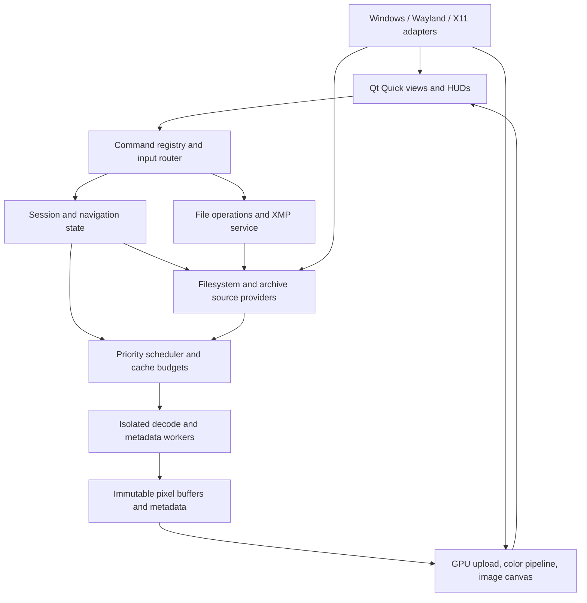

# Glancelot: product, architecture, and delivery plan

Planning baseline: October 17, 2026. This is the living product roadmap. The architecture and acceptance budgets below remain targets where implementation or qualification evidence is absent.

Approved roadmap amendment, October 17, 2026: the approved sequence inserted **M2.1: folder tree and window resume** before M3. Prioritize the collapsible folder navigation tree before the remaining M3 browsing features. Add persistent last-folder/last-image positions for window slots 1, 2, 3, and so on, assigned in window-opening order and restored across complete application exits. This amendment supersedes the earlier M3 scheduling of the core tree and the optional treatment of browsing-position persistence; the original supplied feature specification remains unchanged.

Approved workspace amendment, October 17, 2026: prioritize PATH-BAR-01, PANES-01, GRID-PREVIEW-01, FILE-GRID-01, DELETE-01, DELETE-KEYS-01, UI-SETTINGS-01 and TOPBAR-THEME-01 ahead of the remaining M3 queue. Add a copyable/editable folder address above the tree; resize/move/freeze primary panes; show grid and preview together; browse and multiselect files/folders; explicitly delete grid entries and tree folders with separate current-file/current-folder shortcuts; expose advanced customization; match the top bar to the selected theme. See UX-13 through UX-18 and FS-01/FS-02 in REQUIREMENTS.md for acceptance and WORK-QUEUE.yaml for dependencies.

Freeze means locking a pane's position and size while keeping its content interactive; movement initially means rearrangement/re-docking within the application window. Trash/Recycle Bin is the deletion default with explicit targets, cancellation/partial-failure handling and no silent permanent fallback. This advances only the explicit deletion slice and its SYS-06 safety gate into M3; tagged copy/move and other M4 workflows keep their existing scope. UI settings extend the existing portable configuration, preserving themes, bindings and window slots. Platform, resource, source-safety and independent-review gates remain required; this amendment does not claim any implementation.

Build a native, local-first Windows/Linux photo viewer whose distinguishing strengths are predictable folder traversal, fully configurable interaction, accurate image display, and a quiet interface. Make those strengths dependable before pursuing the entire format and diagnostics wishlist.

The original planning task began in an empty workspace. The repository now contains a C++20 / Qt 6.8.3 Windows alpha, local toolchain, GPL-3.0-or-later license, tests, and portable packaging. Treat that earlier planning baseline as history rather than a statement of current delivery.

Current delivery: JPEG/PNG canvas viewing, deterministic traversal, remappable keyboard commands, themes, worker-backed filmstrip, lazy folder tree, numbered-window resume, and folder grid are implemented on Windows. Name/modified/size/seeded-shuffle sorting is implemented and independently reviewed on Windows. See [the live work queue](WORK-QUEUE.yaml), [agent execution plan](AGENT-BUILD-PLAN.md), and [whole-code audit](verification/CLAUDE-AUDIT.md). Neither the Windows alpha nor passing offscreen UI tests completes the Linux GUI, physical pixel/color, HDR, performance, storage, or stable-release gates.

Companion documents:

- [Original specification](original-feature-specification.txt): unchanged user-provided input.
- [Requirements and acceptance matrix](REQUIREMENTS.md): feature-by-feature scope, milestone, and verification requirements.
- [First implementation backlog](FIRST-MILESTONE.md): concrete feasibility experiments and initial implementation sequence.
- [Feature opportunities and UX strategy](FEATURE-OPPORTUNITIES.md): 80 evaluated candidates, their value, dependencies, acceptance and recommended promotion sequence; existing priorities remain first.
- [Platform performance strategy](PERFORMANCE-STRATEGY.md): measured pipeline optimization, Windows/Linux/Docker/Unraid/WSL plans, resource budgets, proposed work packets and qualification evidence.
- [Second-monitor support and customization](SECOND-MONITOR-PLAN.md): approved UX-10 delivery packets for clean output, display routing, presets, independent viewports and hotplug recovery in M5.

## 1. Product boundaries and assumptions

**Primary users:** people rapidly browsing folders and camera bursts; photographers culling before an external editor; artists inspecting and referencing images; technical users examining pixels, channels, and metadata.

**Product promise:** open a file immediately without import; navigate a directory tree predictably; inspect it accurately; select and hand off files without surrendering control of the filesystem.

No accounts, cloud synchronization, telemetry, mandatory library database, destructive adjustment editor, background machine-wide scanning, or automatic metadata rewriting. Local and mounted network files are first-class sources. Optional disposable caches are not a catalog or source of truth. AI metadata inspection is local parsing, not an AI service.

Confirmed user direction and remaining planning assumptions:

- The user confirmed a solo maintainer with AI assistance and requested a technology/license recommendation based on performance and maintainability. Estimates assume an experienced full-time maintainer with access to real Windows and Linux machines. AI assistance does not replace human review of color correctness, data safety, platform behavior, or licenses.
- Windows 11 x64 and Linux x86-64 first; test Wayland and X11. Select and record exact supported OS, distribution, compositor, driver, and toolkit versions in milestone M0. ARM64 and older Windows versions require a separate support decision.
- Qt/C++ is the recommended starting candidate; GPL-3.0-or-later is the proposed application license. Neither has been adopted by this document.
- A focused v1 is acceptable; all attached requirements remain tracked, including deferred and conditional features.
- Shipping packages include their supported decoders; users do not need store codec packs. Unsupported capabilities must be visible, not silently advertised as supported.

### First stable release boundary

V1 should be an excellent everyday viewer and culling companion: directory traversal, all basic input remapping, windowed/frameless/fullscreen viewing, four HUD regions, grid and filmstrip, fit/pan/zoom/loupe, bounded prefetch, common raster/RAW preview support, SDR color management, 2-up/4-up comparison, metadata, session tagging, tested XMP ratings, safe file operations, external handoff, and straightforward installation.

Basic animated GIF/WebP/APNG playback and TIFF page navigation belong in v1. Advanced timelines, HDR display output, gain-map variants, motion video, comics modes, extensive archive families, and specialist design/game formats follow in explicit expansion releases. Supporting a filename extension is not proof that every subtype, bit depth, animation mode, or camera model works.

## 2. Resolve specification ambiguities before implementation

| Requirement in the input | Engineering interpretation |
| --- | --- |
| Zero latency; zero dropped frames at 240 Hz | Measure latency distributions and missed frame budgets on named hardware. Guarantee responsive cancellation and bounded work; treat 240 Hz as a qualified target, not a universal promise. |
| Under 100 ms cold start | Preserve as a stretch target on the reference NVMe JPEG workload. Distinguish process startup with warm OS caches from an actually cold filesystem cache. Measure first correct image, not an empty window. |
| RAW preview under 20 ms | Measure embedded-preview extraction separately from file reads, JPEG decoding, color conversion, and presentation. Some files lack a usable or full-resolution preview. |
| Full 10/16/32-bit swapchain support | Separate decoded precision, working texture precision, and supported display surface formats. HDR10 and FP16 scRGB are candidates; a 32-bit-float working image does not require a 32-bit-float swapchain. Qt documents distinct HDR surface formats. [Qt HDR surfaces](https://doc.qt.io/qt-6.11/qrhiswapchain.html) |
| OS-style alphanumeric traversal | Define a portable natural-name comparator with numeric runs and deterministic tie-breaking. Windows and Linux file managers do not supply one universal ordering. |
| Skip folders under active filters, but clear temporary filters at boundaries | Persistent format/exclusion filters determine eligible destination folders. Temporary session filters are removed from the candidate query and cleared only when a boundary transition commits. |
| 100% Lightroom/Capture One/darktable XMP compatibility | Publish a tested application/version/property matrix. Ratings, labels, pick/reject semantics, sidecar names, and synchronization behavior require separate validation. darktable explicitly documents naming differences. [darktable sidecar import](https://docs.darktable.org/usermanual/development/en/overview/sidecar-files/sidecar-import/) |
| No destructive editing, plus lossless JPEG rotation | View rotation is transient. A separate, explicit file-transform command may update source metadata or JPEG blocks; it is a file mutation with recovery and validation requirements. |
| Archives entirely in RAM | Never extract archive entries to disk during viewing. Read archive bytes through seekable input and decompress bounded entries into memory; do not load the entire archive. Solid compression can require expensive sequential decompression. [libarchive format support](https://github.com/libarchive/libarchive) |
| Apple Live Photos as embedded video | Model a media asset that may contain separate still/video resources, as well as embedded Android motion-photo payloads. [Apple paired video](https://developer.apple.com/documentation/photos/phassetresourcetype/pairedvideo) and [Android motion-photo format](https://developer.android.com/media/platform/motion-photo-format) |
| Every input combination and window feature | Support inputs delivered to the application. OS/compositor-reserved gestures and shortcuts cannot be guaranteed. Report unsupported pinning, placement, opacity, or global recovery capabilities. Wayland does not generally allow application-controlled absolute placement. [Qt window behavior](https://doc.qt.io/qt-6.12/qwindow.html) |

These interpretations preserve the intended experience while making acceptance tests possible. Any deviation that changes user-visible behavior should be recorded in an architecture decision record (ADR).

## 3. Technology decision

### Recommended candidate: C++20, Qt 6 Quick/QML, custom GPU canvas

Use QML for controls, panels, accessibility, focus, and layout. Use C++ for navigation, scheduling, resource ownership, metadata integration, and image processing. Avoid feeding full-resolution photos through generic UI image elements as the main rendering path.

Qt Quick already renders through a graphics abstraction supporting Direct3D, Vulkan, and other backends. Therefore, Qt itself is not evidence of a CPU-bound viewer. Explicitly test D3D12 on Windows and Vulkan on Linux; retain tested D3D11/OpenGL alternatives when needed. Qt's platform defaults may differ from the preferred backend. [Qt scene graph renderer](https://doc.qt.io/qt-6/qtquick-visualcanvas-scenegraph-renderer.html)

Prototype the canvas with QQuickRhiItem and isolate its QRhi implementation in one module. QQuickRhiItem is public, but QRhi has limited compatibility guarantees, and the item adds an offscreen composition stage. Pin the toolkit version and measure that stage before committing. Do not assume the software scene-graph adaptation runs this item; implement a separate reduced-function fallback if supported hardware coverage requires it. [QQuickRhiItem contract](https://doc.qt.io/qt-6/qquickrhiitem.html)

| Candidate | Advantages for this project | Main costs and decision |
| --- | --- | --- |
| C++20 + Qt Quick + GPU canvas | Established desktop interaction model; direct integration with native image libraries; one main implementation language | Memory-safety discipline, dependency packaging, QRhi upgrade testing. Recommended if M0 passes. |
| Rust + winit/wgpu + egui or another validated Rust UI toolkit | Strong ownership model; native rendering; direct D3D12/Vulkan backend support | Validate screen-reader support, text/IME, multi-window behavior, dialogs, polish, and HDR integration before selection. Preferred alternative if Rust expertise or a permissive source license is a priority. |
| Rust core + Qt shell | Rust ownership in the domain layer with Qt UI | Adds FFI, two toolchains, and cross-language debugging. Defer unless staffing or measured risk justifies it. |
| Electron/Tauri or a browser canvas | Productive web UI development | Requires additional native integration and measurement for precise presentation/color/latency goals. Not the starting choice for this specification. |

These tradeoffs are engineering judgments, not measured benchmark results. wgpu documents native D3D12/Vulkan backends and surface color-space configuration; Rust must not be rejected on an outdated assumption that HDR is categorically absent. [wgpu backends](https://docs.rs/wgpu/latest/wgpu/struct.Backends.html), [surface configuration](https://docs.rs/wgpu/latest/wgpu/type.SurfaceConfiguration.html). egui documents AccessKit integration, which still requires application-level accessibility testing. [egui accessibility](https://github.com/emilk/egui/blob/main/docs/accessibility.md)

### License and dependency strategy

Propose GPL-3.0-or-later for the application to support a community-maintained desktop utility and a broad codec/metadata ecosystem. Validate the exact selected dependency versions and their compatibility before adopting it. If permissive application licensing is preferred, reassess the metadata implementation and every copyleft dependency; changing the language alone does not resolve dependency obligations.

Qt has multiple licensing routes and module-specific differences. Prefer locally bundled shared libraries and a documented packaging/source-compliance process rather than assuming static linkage is automatically acceptable. LibRaw offers LGPL/CDDL choices; libheif is LGPL and depends on independently licensed codec backends. [Qt licensing](https://doc.qt.io/qt-6/licensing.html), [LibRaw licensing](https://www.libraw.org/about), [libheif](https://github.com/strukturag/libheif)

For every shipped dependency, record version, hash, source URL, SPDX expression, transitive dependencies, build flags, notices, source/relink obligations, known vulnerabilities, and update owner. Assess codec patent/distribution questions for the intended release territories before bundling HEVC/video components. This is a specific release work item, not a reason to delay the basic JPEG/PNG viewer.

No stable third-party binary plugin ABI in v1. Use internal decoder adapters with explicit capabilities. This keeps updates and debugging manageable without blocking future plugins.

## 4. Architecture and ownership



The diagram shows logical flow, not permission for cyclic ownership. UI sends typed commands; the application publishes immutable snapshots/events. The renderer never mutates navigation or opens arbitrary files. Decoder workers never manipulate UI state or write originals.

| Module | Owns | Must not do |
| --- | --- | --- |
| `core` | Stable IDs, command definitions, navigation rules, sorting, filtering, viewport mathematics | Depend on QML objects or block on storage |
| `sources` | Directory enumeration, archive indexes, file identity and revision, capability reporting | Perform eager whole-library scans |
| `scheduler` | Priorities, cancellation, worker admission, memory reservations, storage hints | Allow unlimited queues or nested decoder thread explosions |
| `decode-worker` | Format probing, previews, full decode, frame/page decode, bounded metadata parsing | Keep exclusive source locks, execute metadata, access network services |
| `render` | GPU resources, transforms, resampling, color conversion, diagnostics, presentation | Own filesystem traversal or write source files |
| `metadata` | Read models, XMP property policy, AI payload extraction, interoperability profiles | Rewrite unknown sidecar namespaces or execute workflow JSON |
| `file-ops` | Copy/move/trash, conflict detection, operation journals, recovery | Silently overwrite files or fall back from trash to permanent deletion |
| `platform` | File watching, monitor/color capabilities, window flags, clipboard, shell, IPC | Pretend every compositor supports every capability |
| `ui` | Canvas overlays, tree/grid/filmstrip, settings, accessible command presentation | Define separate business rules for mouse and keyboard paths |

Use CMake presets and a pinned dependency manifest, initially evaluate vcpkg. Keep domain tests runnable without a display. Prefer a small explicit architecture over a generic plugin framework or microservices.

### Core data contracts

- `AssetId`: source-provider identity plus stable entry identity; never a thumbnail-grid row index. Local identity can use filesystem IDs where reliable, with a documented path fallback.
- `SourceRevision`: identity, size, modification state, and watcher generation; use additional validation when timestamps are too coarse. Archive entries also include the container revision.
- `NavigationSnapshot`: traversal root, current directory, file ordering, persistent filters, temporary filters, current asset, history, and shuffle seed.
- `DecodeRequest`: asset/revision, quality tier, requested region/resolution/frame, priority, memory allowance, cancellation generation.
- `PixelBuffer`: dimensions, stride, channels, bit depth, orientation, alpha convention, source color description, frame/page identity, preview/full-resolution status.
- `ViewportState`: fit mode, physical-pixel scale, orientation, normalized center, and per-view lock state.
- `DisplayCapabilities`: backend, output identity, scale factor, HDR/color-management support, effective presentation mode, and restrictions.
- `Command`: stable ID, label, parameters, valid contexts, repeat policy, enablement predicate, begin/end semantics, and mutation category.

All asynchronous results carry generation and revision identifiers. Discard an outdated result before it can replace the current image. GPU upload and pixel allocation require a budget reservation first; completion releases it exactly once.

### Worker boundary

Use a small reusable process pool for native decoders and complex metadata parsers. Bound IPC messages and shared-memory allocations. Validate dimensions/stride/byte counts in both worker and parent. A crashed or timed-out worker reports a recoverable per-file error and is replaced.

Process separation alone is not a security sandbox. Apply tested OS restrictions: no network, limited handles/files, process and memory limits, and write restrictions using appropriate Windows and Linux mechanisms. If a restriction cannot be enforced on a target, document that limitation. Thread cancellation is insufficient for a wedged third-party decoder; worker termination provides a deadline boundary.

Spawn workers lazily/concurrently with UI startup, and measure the IPC/shared-memory cost in M0. Do not discard isolation merely to improve an empty-window timing number.

## 5. Navigation: the first correctness contract

### Tree ordering

The user selects a traversal root; a shell-opened file initially uses its containing directory. Expanding to a parent root is an explicit command. The folder browser independently exposes filesystem locations before any photo is open; explicitly selecting a folder outside the traversal root establishes that folder as the new traversal root. Mounted folders may be listed for explicit selection without permitting automatic traversal across volumes. Never unexpectedly traverse an entire drive or cross into a new mounted volume.

Order directories by a documented natural-name comparator: numeric runs compare numerically, nonnumeric portions use a pinned Unicode/case policy, and raw-name identity provides a stable final tie-break. Retain filesystem-native paths, including non-UTF-8 Linux names; normalized display text is not a file identifier. Folder ordering is independent of the active file ordering.

Use preorder depth-first directory traversal: visit a directory's eligible files, then its child directories recursively in folder order, then the next sibling subtree. Example:

```text
root/                  files: a.jpg, b.jpg
  01-trip/             files: c.jpg
    01-details/        files: d.jpg
  02-empty/            files: none
  10-family/           files: e.jpg, f.jpg

Forward sequence: a, b, c, d, e, f
Backward sequence: f, e, d, c, b, a
```

Explicit Next Folder lands at the first eligible image of the next eligible directory. Previous Folder lands at the last eligible image of the prior directory in the same traversal order, including the deepest applicable preceding subtree. Tests must prove the reverse relation, not implement two unrelated algorithms.

Boundary policies for normal image navigation: stop, wrap within current folder, or continue through the traversal root. At the end of the root, stop with a subtle status hint unless root-wide wrap is separately enabled. Ignore permission-denied directories during traversal while making skipped counts available in diagnostics. An inaccessible initial file produces an actionable error.

Do not follow symlink/junction directory targets by default. Optional following requires a visited-identity set, root/volume policy, and cycle tests. Hard links, renames, and disappearing directories must not create infinite loops.

### Filters, sort, and changing files

Persistent filters include supported media types and explicit folder exclusions. Temporary filters include tagged-only. Resolve destination candidates against the effective persistent filter, then atomically clear temporary filters when the directory change succeeds. If no destination exists, keep the original directory and its temporary filters unchanged. Preserve session tags themselves across boundaries.

Within a folder support natural name, modified time, capture time, size, dimensions, and deterministic shuffle. Define missing metadata ordering and tie-break by stable name/identity. Capture-time sorting uses documented timezone/unknown-time handling. Background metadata discovery must not continuously reorder the file being viewed: use an explicit completed sort snapshot or a user-triggered refresh. Seed shuffle per session and preserve it for backward navigation.

Large directories enumerate incrementally; show a provisional index such as `142 / scanning` until the count is known. Opening the requested file must not wait for enumeration or metadata sorting.

Watch both directory and file changes. Preserve the active asset through renames where identity permits. For an external delete, select the next surviving item from the old ordering, then the previous item if necessary, then apply the boundary policy. Use bounded recovery when a folder disappears or a network source disconnects.

### Lookahead

Prefetch on both sides of the current image and begin cross-folder lookahead no later than the final three eligible images. Scale lookahead to navigation velocity and observed decode time. Prioritize current image, visible comparison panes, imminent next image, reverse buffer, thumbnails, then metadata/idle work. Direction reversal cancels obsolete tasks promptly.

Do not pre-enumerate the whole tree to find one successor. Keep an iterator stack and cached directory snapshots; permission failures and empty folders must remain cancellable.

## 6. Rendering, memory, and I/O

### Image lifecycle

1. Accept path and show the window; open the requested asset independently of directory scanning.
2. Probe bounded header data for format, dimensions, orientation, preview availability, and color information.
3. Display a correctly oriented/profiled embedded or reduced-resolution preview when available; mark it as a preview.
4. Decode the requested resolution/frame or full image in a worker.
5. Upload within a per-frame byte/time budget, avoiding long render-thread stalls.
6. Replace the preview without changing the user's chosen center/zoom. Never silently describe a small preview as full-resolution 100% inspection.
7. Schedule neighbors, thumbnails, and optional diagnostics only after current work is admitted.

For RAW, embedded JPEG is the default fast route. Full sensor decode is explicit or preference-controlled on zoom; absent or small previews fall back gracefully. Do not promise identical rendering to camera software or Lightroom. LibRaw documents the limits of its rendering scope. [LibRaw project description](https://www.libraw.org/about)

### Cache model

Use separate bounded caches for compressed/source blocks, metadata, thumbnails, decoded CPU images, GPU tiles/mips, and animation frames. The logical navigation ring is an access policy, not an instruction to store every neighbor at full resolution on the GPU.

A 60-million-pixel image needs approximately 240 MB in RGBA8 or 480 MB in RGBA16F before temporary buffers. Full mipmaps add about one-third; four comparison panes plus staging buffers can quickly exceed available memory. Budget decoder working allocations, CPU/GPU duplication, and shared-memory buffers, not just final textures.

Proposed initial CPU cache cap: the minimum of a user cap (start at 1 GiB), 20% of physical RAM, and 40% of currently available RAM, subject to a minimum OS headroom reserve. Treat this as a tunable starting policy, not a benchmark finding. Re-evaluate memory pressure with hysteresis; never grow aggressively simply because a previous eviction increased free memory.

GPU cache cap: use reported allocation budgets where available and a conservative fallback otherwise; start at at most 20% of the usable budget with a 512 MiB default ceiling. Account jointly for shared-memory integrated GPUs. Reduce resolution or evict neighbors before evicting the active viewport. If one image cannot fit, use scaled decode or tiles; when the codec lacks that ability, offer a clear resource-limit failure.

Use tile/page working sets for huge images and continuous strip mode. Not every decoder provides random region access: explicitly distinguish true regional decode from a full decode followed by tiling. Never advertise bounded full-resolution viewing of arbitrary gigapixel files without such a decoder path.

### Storage scheduling

Use mount/device hints as an initial estimate, then adapt to measured read latency, throughput, and queue depth. Device classification can be wrong for USB, RAID, virtual drives, FUSE, and network mounts. Provide an override.

Start conservatively: one sequential read for HDD/network sources, a small bounded pool for local SSD, and additional CPU decode work only when memory permits. Bound library-internal threading as part of the same global budget. Cancel lookahead on NAS disconnect; retain the current decoded image and allow navigation elsewhere.

### Refresh and device recovery

Render on demand while idle; use frame scheduling during interactions and animation. Frame pacing follows the actual output, including mixed-refresh monitor changes. View transforms must not trigger image re-decode.

Handle resize, minimize, monitor removal, suspend/resume, GPU device loss, and remote desktop. Rebuild GPU resources from CPU/source state; preserve navigation and user selections. An HDR/backend failure falls back to an explicitly identified SDR path.

### File sharing and hot reload

Open Windows files with read/write/delete sharing where appropriate; short-lived read handles and detached decoded buffers reduce interference with external writers. Windows sharing flags are explicit API behavior. [CreateFileW](https://learn.microsoft.com/en-us/windows/win32/api/fileapi/nf-fileapi-createfilew)

Avoid long-lived source mappings that prevent replacement or become invalid during truncation. Detect atomic-save renames as well as in-place writes. Debounce incomplete writes, retry with bounds, and swap only a validated new revision. The current good image stays visible during a partially written replacement. The 50 ms target applies to watcher response/scheduling on supported local filesystems, not guaranteed completion of a huge decode or delivery of remote notifications. Provide rescan/polling fallback when watchers lose events.

## 7. Color, zoom, and inspection correctness

Keep source code values and metadata distinct from display pixels. The conceptual rendering pipeline is:

```text
decode and interpret alpha/orientation
  -> source profile / transfer-function interpretation
  -> linear working space with defined primaries
  -> premultiplied-alpha filtering, resampling and view transforms
  -> optional view-only diagnostics / tone mapping / proofing
  -> negotiated output color encoding and presentation
```

Use Little CMS as a candidate ICC engine and CPU reference, with validated GPU matrix/curve or LUT transforms where appropriate. Preserve 16-bit/float precision where needed; do not convert every source through 8-bit sRGB. Handle CMYK JPEG/TIFF and invalid/missing profiles explicitly. Color conversion and alpha premultiplication order need reference tests to prevent dark fringes.

SDR is the first release gate. Detect display/profile changes, invalidate only dependent transforms, and choose a deterministic owning display for spanning windows. For dual-output presentation, use independent output transforms. On compositor-managed paths, submit the correct content description and avoid applying the monitor transform twice. If the required API is absent, identify the fallback as assumed sRGB or unmanaged rather than claiming calibrated output. Wayland color-management support is negotiated by protocol capabilities. [Wayland color-management protocol](https://wayland.app/protocols/color-management-v1)

HDR output is a later, separately certified path. Test Windows and specific Linux compositor/driver combinations. Use FP16 working textures where appropriate and the negotiated output format. Keep HUD luminance tied to SDR reference white rather than making UI controls excessively bright. Handle display headroom and SDR fallback continuously. Add Ultra HDR, ISO gain-map variants, and Apple Adaptive HDR as separately versioned decoders with fixtures; one successful Ultra HDR JPEG does not prove support for every gain-map container. [Ultra HDR reference implementation](https://github.com/google/libultrahdr)

Define fit mathematically on the orientation-corrected physical viewport: fit=min(viewport/image axis ratios), shrink-only=min(1,fit), fill=max(axis ratios), fit width and fit height independently. At 100%, one source pixel occupies one physical display pixel even when UI controls use device-independent units. Test 125%, 150%, 175%, 200%, and mixed-DPI monitor transitions.

Cursor zoom keeps the same image coordinate beneath the cursor. Loupe saves the complete previous viewport and restores it on release, focus loss, pointer cancellation, or image change. Comparison supports normalized-position lock and an explicit same-pixel-scale mode; differing dimensions/aspect ratios require defined clamping.

Default downscaling should balance clarity and cost; compare area/mipmap-assisted reduction, bicubic, Mitchell, and Lanczos3 on reference images. Large reductions require appropriate prefiltering, not just a few fixed taps. Sharpening is optional and off for numeric/pixel-exact inspection. Nearest-neighbor upscaling is an explicit pixel-art mode.

Histograms and samplers identify their domain: source values, linear working values, or display preview. Whole-image and visible-region histograms use bounded asynchronous computation with visible freshness state. Approximate sampled histograms must be marked approximate; offer exact calculation on demand. Source clipping adapts to bit depth and distinguishes all-channel clipping from any-channel warnings. HDR clipping is not defined by the 8-bit number 255.

RGB/hex values name their color space; Lab names its reference white. CMYK requires a chosen output profile and is a conversion, not an intrinsic property of an RGB pixel. Disclose alpha and out-of-gamut/clamped values.

## 8. UX and interaction specification

### View modes

| Mode | Primary task | Persistent visible content |
| --- | --- | --- |
| Canvas | Look at one image | Image; optional pinned HUD/status |
| Browser | Find/select images | Virtualized grid and compact location/tree controls |
| Compare | Judge 2 or 4 candidates | Image panes, active-pane indication, restrained rating/status |
| Reference | Keep an image available while working | Frameless pinned image plus a reliable recovery control |
| Presentation | Browse privately while showing output | Controller window; clean second-output canvas |

Use one shared session model across modes. Comparison selection, session tags, and keyboard focus are distinct states. Dropping a comparison candidate must not delete its source or automatically mark it rejected without the corresponding command.

### Minimal visual system

The image is the focal point. Use flat surfaces, concise labels, subtle separators, one consistent icon family, and small contextual controls. Avoid decorative gradients, large card layouts, promotional onboarding, and frosted surfaces that make metadata difficult to read. Translucent HUDs get an opaque accessibility alternative.

The supplied canvas presets are product-defined: black, neutral dark gray, middle-gray preset, white, custom color, checkerboard, and optional ambient backdrop. Clarify that a literal hex preset is not a monitor calibration reference. Ambient backdrops use a reduced-resolution image and are off in color-evaluation workflows.

Use platform UI font behavior as the accessibility baseline; evaluate Geist Sans/Geist Mono as optional bundled alternatives after font-license and glyph-coverage checks. Keep a restrained text scale and tabular numeric readouts. Let UI text scale independently of photo zoom. Respect system contrast, text size, and reduced motion.

### Four-edge HUD behavior

```text
+----------------------------------------------------------------+
| TOP: filmstrip, filters, sorting                                |
|                                                                |
| LEFT: tree         IMAGE CANVAS             RIGHT: metadata,    |
|       favorites                             histogram, color   |
|                                                                |
| BOTTOM: zoom, dimensions, coordinates, index, actions            |
+----------------------------------------------------------------+
```

All HUDs auto-hide in immersive viewing; each may be pinned, opened by a command, or reached by keyboard. The bottom HUD exposes a menu/exit route. A brief dismissible first-run hint explains controls without blocking the initial image.

Deliver the **collapsible left folder tree in M2.1**, the next milestone after the current alpha/filmstrip integration. Include expand/collapse, lazy child loading, current-folder indication, folder selection, a remappable show/hide command, keyboard navigation and pin/auto-hide behavior. Apply the relevant ui-design-skills to its native Qt/QML design and review, preserving theme tokens in dark and light modes. Favorites and the remaining browser grid/filter/sort features stay in M3; they must not postpone the core tree.

Specify each panel as Hidden -> Armed -> Visible -> Pinned. Proposed defaults for usability testing: 250 ms edge dwell, 500 ms dismissal delay, 4 device-independent-pixel activation band. Do not open on a fast pointer crossing, active pan/loupe/drag, or when a modal owns input. Keep a panel open while its controls have focus; resolve corner collisions by explicit priority. Tune using real mouse/trackpad sessions.

Frameless is the proposed default requested by the specification. Provide standard decorated-window mode, resize handles, system move/resize support, context menu, keyboard alternatives, and an always-recoverable Exit Fullscreen/Show Controls action. Dynamic window-size-to-image behavior is optional and bounded by the work area; do not unexpectedly resize on every image by default.

Click-through reference mode needs a recovery path independent of the click-through canvas, such as a control window or supported tray action. If reliable recovery/pinning cannot be provided on a compositor, disable the affected option with a reason. Monitor removal returns the presentation to a surviving screen.

### Unified command/input system

Register every user-facing action once. Palette, menus, buttons, gestures, scripts/handoff slots, and shortcuts invoke that registry. No hidden hardcoded alternative route for core actions.

Input precedence: modal/shortcut capture, text entry, focused control, active view, then application scope. Canvas shortcuts must not steal text or arrow input from editable controls. A deterministic resolver detects duplicate and overlapping bindings. A settings recorder shows what input the OS actually delivered and explains reserved/unavailable combinations.

Support keyboard keys, modifiers, mouse buttons 1-5, wheel axes, double-clicks, supported gestures, chords with a visible pending state, and hold begin/end commands. Handle layout-sensitive characters separately from physical key codes. Normalize high-resolution wheel deltas and distinguish discrete wheel navigation from continuous trackpad pan/pinch. Avoid accidental dozens-of-images skips from one touchpad gesture.

Expose the scroll matrix as a small dedicated settings page: base wheel behavior plus modifier overrides. Context presets: Viewer, FastStone-inspired, and custom. Defaults are editable; provide per-action, per-context, and complete reset. Suggested defaults: arrows for previous/next, wheel navigation over the canvas, Ctrl+wheel cursor zoom, Space session tag, 1-5 ratings, Escape dismiss/exit immersive mode, Ctrl+Shift+P palette. Grid wheel scrolls the grid. Validate double-click/fullscreen and hold/loupe arbitration so they do not fight.

### Configuration and settings

Use one versioned UTF-8 `settings.json` for preferences, bindings, layouts, external tools, required per-window browsing positions and other optional session state. Store optional caches and operation journals separately; they are not portable preferences. Support explicit portable mode and normal OS config locations.

### Persistent browsing position per window (M2.1)

Assign stable numbered slots by window-opening order within an application session: the first window is slot 1, the second is slot 2, and so on. Each slot stores its own last folder and image path. The first window opened after a complete exit restores slot 1; the next window restores slot 2 when opened. Do not automatically reopen all saved windows merely to restore their positions.

Keep each live window's slot fixed until it closes. Closing windows out of order must not renumber remaining windows or overwrite another slot; a newly opened window takes the next opening-order slot, and closed slots remain saved for future application sessions. A new full application session starts the opening-order counter at 1. Coordinate slot assignment and writes across independent viewer processes as well as multiple windows in one process.

Persist the latest successful folder/image selection during browsing with debounced atomic writes, and flush on window close and normal application exit. Retain slots not opened during the current session. Persist an image's identity/path rather than only its list index, so sorting changes do not restore a different photo. This feature stores browsing location; zoom/pan state, selection tags and window geometry are separate requirements.

An explicitly supplied file takes precedence over restoration for that window and becomes its remembered location only after a successful open. If a remembered image is missing, retain the saved folder and select its first eligible image if available. If the folder is missing, inaccessible or empty, show an actionable state without an automatic drive-wide scan or deleting the saved location. Failed/partial restores must not clobber valid slots. Preserve bindings, theme settings and unknown supported preference fields when saving positions.

Acceptance: browse different folders/images in two or more windows; close them in both normal and reversed order; exit the entire application; reopen windows one by one and verify the correct slot-specific locations. Also test a later session opening only one window, different file sorting, deleted images/folders, empty or disconnected sources, explicit shell-open overrides, simultaneous process launches and interrupted settings writes.

Validate before applying; write atomically with last-known-good backup. Preserve unknown fields when feasible, back up before migration, reject unsupported future schemas gracefully, and expose a reset/safe-mode launch option. OS-specific bindings can coexist in one file. Monitor IDs/paths use fallbacks on another machine. Never execute external tool definitions merely because a config was imported; show them for review and run only on an explicit handoff action.

Settings groups: Viewing, Navigation, Controls, Appearance, Color, Performance, Metadata & Culling, External Tools, Advanced. Include search and contextual previews. Avoid dumping every advanced setting into the primary canvas.

### Design deliverables and validation

Before implementing the full shell, produce grayscale wireframes for canvas with each HUD, browser, compare, settings/remapping, empty folder, decode failure, missing network share, metadata conflict, and presentation controller. Create an interactive desktop prototype only after the framework spike.

Test five workflows with at least five representative users: shell-open and traverse folders; rebind wheel/context actions; compare and rate a burst; inspect a pixel/profile; recover from a hidden or click-through window. Include a keyboard-only session and screen-reader testing with NVDA and Orca. Record completion, wrong turns, accidental actions, focus loss, and qualitative feedback. Target no unrecoverable state or accidental file mutation and at least 4/5 unaided completion per core workflow before beta; use failures to revise the design.

## 9. Metadata, culling, and safe handoff

Parse EXIF/IPTC/XMP lazily. The initial image does not wait for a complete metadata tree. Exiv2 is a candidate; inspect its exact source-license notices and selected version before integration. Keep metadata parsing inside the bounded worker boundary. [Exiv2 license text](https://raw.githubusercontent.com/Exiv2/exiv2/main/COPYING)

Treat Stable Diffusion text, ComfyUI graphs, and other AI metadata as untrusted text/JSON. Limit decompressed chunk size, nesting, and displayed lengths. Provide raw-copy fallback when a schema is unknown. Do not promise a proprietary metadata schema without real fixtures. GPS map launch is an explicit external-browser action that reveals coordinates to the selected service; there is no automatic lookup.

XMP writes preserve unknown namespaces/properties and merge only owned fields. Use read-revision -> edit owned properties -> conflict check -> atomic replacement, plus recoverable backup/journal where needed. Check filesystem-specific atomicity/durability; treat network failures as pending/failed, not saved. Coordinate the app's own multiple instances and detect external changes. Display pending/save-error state on the affected rating.

Choose sidecar naming using documented interoperability profiles. Handle RAW+JPEG same-stem collisions. Test ratings, labels, reject and pick independently for named Lightroom, Capture One, and darktable versions; publish unsupported mappings. Never write both naming styles blindly or overwrite another application's edit settings. Conflicting embedded versus sidecar metadata has an explicit precedence policy.

Session tags are ephemeral, separate from persistent ratings; optional session restoration is user-controlled. Batch operations capture an explicit target snapshot so a filter change cannot alter a running job. Treat companion sidecars and paired media as a configurable asset group.

Copy/move/trash operations preflight permissions, space, collisions, target nesting, and cross-volume behavior. For cross-volume moves: copy to a temporary destination, verify completion and appropriate integrity, commit destination, then remove source. Support cancellation and partial-failure reporting. Trash is the default delete; if unsupported, ask specifically before permanent deletion. Undo is advertised only while recovery is actually possible. Never claim a multi-file batch is an atomic filesystem transaction.

External tool slots use executable-plus-argument arrays, not shell string concatenation. Define `{file}` and `{files}` expansion, quoting behavior, working directory, and argument-length handling. Handle spaces, Unicode, shell metacharacters, and leading dashes. Launching external tools is always a user action.

Clipboard commands distinguish rendered bitmap (with chosen output color conversion), file objects/URIs, path text, and Base64 data URI. Large copies are cancellable and bounded. Lossless JPEG file transforms require perfect MCU transforms or an explicit alternative; never silently trim edges. View-only rotation remains the default.

## 10. Formats and specialized modes

Build decoder capability records: still/animated/multipage, preview/full, integer/float precision, alpha, ICC/HDR, random access, and resource limits. Sniff content as well as extensions. Each claimed capability gets fixtures and malformed-input tests.

| Delivery group | Candidate implementation | Scope and limitations |
| --- | --- | --- |
| Core raster | libjpeg-turbo, libpng, libtiff, libwebp; vetted BMP/TGA/GIF/ICO/QOI readers | JPEG/PNG first; then TIFF pages, WebP, GIF/APNG and common utility formats. CMYK, transparency, orientation, and animation disposal need explicit coverage. |
| RAW | LibRaw adapters | Preview path first, then optional full development. Publish camera/model/variant support, not just extension lists. |
| AVIF/JXL/HEIF | libavif + dav1d, libjxl, libheif + selected decoder | AVIF/JXL stills before advanced sequences; HEIF decode and distribution assessed separately. |
| HDR source | OpenEXR, Radiance reader, high-bit-depth TIFF, libultrahdr and gain-map adapters | SDR tone mapping can precede native HDR output. Declare EXR channel/layer/deep-data limitations. |
| Vector/design | resvg through a narrow ABI or another validated renderer; vetted composite readers | Disable remote resources/scripts; SVGZ decompression limits. PSD/PSB flattened composites, KRA merged preview, ICNS variants. CLIP is conditional on a maintainable decoder and fixtures. |
| Game textures | Vetted DDS/KTX2 readers and transcoders | Publish supported compression, mip, array, cube, and volume slice combinations; never imply complete support from one 2D sample. |
| Containers | libarchive and format-specific adapters where necessary | ZIP/CBZ first; RAR/CBR, 7z, tar later. Expose unsupported encryption/solid variants. No disk extraction during browsing. |
| Motion assets | Bounded demux/decode service with audited FFmpeg or equivalent build | Android payload and Apple paired-file discovery are distinct. Video codec/license/package cost is separate from still-image decoding. |

Krita documents its archive structure and merged preview convention; do not infer the same contract for CLIP. [KRA format](https://docs.krita.org/en/general_concepts/file_formats/file_kra.html)

Archives use the source-provider navigation API with virtual entry IDs. When enabled as folders, they occupy a deterministic position among virtual child directories. Reject path traversal names, symlink escapes, decompression bombs, excessive nesting, and unbounded entry counts. Keep archived sources read-only; persistent metadata/handoff requires an explicit supported export workflow. View operations never silently extract an entry to satisfy an external tool.

Animation uses timestamps and a monotonic clock, with bounded decoded-frame caches and correct disposal/blending. Backward stepping may require replay from a checkpoint. Multi-page TIFF uses page navigation, not assumed frame durations. Frame extraction is an explicit export with overwrite handling.

Continuous strip virtualizes offscreen images and predicts dimensions without fully decoding the folder. Book mode defines cover offsets, odd page counts, reading direction, and boundary behavior. Neither mode may allocate one giant texture representing the whole folder.

## 11. Performance contracts and measurement

The detailed [performance strategy](PERFORMANCE-STRATEGY.md) expands these contracts into shared admission, profiling, storage/cache/decode/render work, platform-specific experiments and release gates. Its additional budgets and configuration profiles are proposals to validate, not measured results or replacements for the contracts below.

All figures below are proposed acceptance budgets, not measured performance claims. M0 records exact hardware, drivers, OS, power policy, build flags, and fixtures, then confirms or revises budgets with reasons.

Reference tiers: R1 modern 16 GiB/NVMe/integrated-GPU SDR machine; R2 8 GiB constrained machine with HDD or throttled storage; R3 discrete GPU plus mixed-DPI SDR/HDR displays; R4 controlled SMB source with documented RTT/throughput. Run Windows and Linux on comparable physical hardware where practical. Hosted CI is not the source of high-refresh or monitor-color claims.

| Metric | Proposed gate | Measurement contract |
| --- | --- | --- |
| Fresh-process first correct image | R1, 24 MP JPEG: p95 <=250 ms with warm filesystem cache; <=750 ms with controlled cold cache | At least 50 runs per condition; shell launch to first presented oriented/color-correct image. Report thumbnail/preview and full-resolution times separately. <100 ms remains a stretch goal. |
| Cached next/previous image | p95 <=1 refresh interval, p99 <=2 intervals | Input event to corresponding presentation; source/texture already resident. Show separate uncached figures. |
| Pan/zoom GPU work | p99 <=6 ms at 144 Hz; qualified 240 Hz target <=3.5 ms | Ten-minute scripted interaction, specified image/filters/overlays. Report total presented-frame pacing as well as GPU timing. |
| Frame-budget misses | <0.1% on the qualified steady-state workload | Count compositor/presentation misses separately from app work; no universal zero-drop claim. |
| 60 MP file opening | R1 p95 <=300 ms usable preview when available; <=1.5 s full JPEG target | Record actual compression, source size, decode tier, and whether a preview existed. RAW gets a separate table. |
| RAW embedded preview | Extraction-only stretch p95 <20 ms; first visible preview target <=250 ms on R1 supported fixtures | Separate read, extract, JPEG decode, color, upload, and presentation timings. |
| Local file change reaction | p95 <=50 ms from watcher receipt to invalidation/reload scheduling | Completion time reported separately; stabilization delay and NAS watcher delivery not hidden. |
| First grid content | p95 <=500 ms for initial visible thumbnails in a 10,000-file R1 folder | No requirement to enumerate/decode all files first; measure scrolling while work continues. |
| Input responsiveness during I/O | No synchronous storage/decode work on UI thread; no app-caused >50 ms UI stalls in stress suite | Include disconnected share, slow metadata, and rapid navigation cancellation. |
| Idle resource use | <1% of one logical CPU over 60 s on R1, static image/no animation | No constant repaint loop; record overlays/watchers and power mode. |
| Memory | Stay within admitted CPU/GPU budgets; no growth trend after repeated loops | 30-minute navigation/compare/animation soak; count worker/staging memory and iGPU sharing. |

Benchmarks store machine-readable results and local traces by stage. CI flags regressions over 10% on dedicated hardware, with a reviewed explanation required for acceptance. Distinguish benchmark noise from changes using repeated runs and retained baseline distributions. No remote telemetry is required; diagnostics are local and users may explicitly export a redacted report.

## 12. Verification and release discipline

### Required test layers

1. **Domain/property tests:** traversal forward/reverse equivalence, boundary modes, temporary-filter reset, sort ties, missing metadata, seeded shuffle, command context precedence, viewport coordinate invariants, and cache accounting.
2. **Filesystem integration:** NTFS and case-sensitive Linux paths; Unicode/non-UTF-8 names; long paths; read-only/permission failures; symlink loops; rename/delete/atomic-save races; SMB disconnection; watcher overflow; sidecar conflicts and cross-volume moves.
3. **Codec conformance:** licensed fixture corpus with expected dimensions, orientation, pixel tolerances, profiles, alpha, frames/pages, truncations, and intentionally malformed inputs. Cover all eight EXIF orientations and animation disposal modes.
4. **Rendering/color tests:** CPU references for resampling/color transforms, bounded-error GPU comparisons, physical-pixel checkerboards at fractional DPI, mixed-monitor changes, and manual calibrated-display/HDR measurements. Screenshots alone cannot establish HDR correctness.
5. **Interaction/accessibility:** real mouse buttons/wheel, high-resolution trackpad, keyboard layouts/IME, focus/loupe release, shortcut conflicts, empty/error states, text scaling, NVDA/Orca, and window recovery.
6. **Fault injection:** worker crash/hang, out-of-memory reservations, full disk, partial file operations, GPU loss, unplugged monitor, power interruption around sidecar save, and stale asynchronous results.
7. **Fuzzing and sanitizers:** parsers, IPC, archive traversal, metadata, and config; ASan/UBSan and targeted race checks where supported. Maintain corpus-based regression cases for every parser crash.
8. **Package tests:** fresh Windows install/portable mode and supported Linux packages; shell association, drag/drop, single-instance routing, upgrade/config migration, uninstall preserving user media/config, and offline launch without developer tools.

Build and run unit/integration tests on Windows and Linux for every change. Run GPU/codec/performance suites on appropriate runners and nightly hardware. Store provenance/licenses for test photos; never commit private photo collections or identifying EXIF data without permission. Release fixture subsets and scripted generators so contributors can reproduce failures.

### Definition of done for a feature

The requirement ID is mapped to implementation and tests; command/menu/settings behavior agrees; loading/empty/error/cancellation states exist; keyboard access works; memory and performance impacts are measured when relevant; both OS families pass or the capability is explicitly restricted; documentation and dependency notices are current. No known silent data-loss bug, false color-accuracy claim, or unbounded allocation is acceptable for stable release.

### Open-source operations

Create README, BUILDING, CONTRIBUTING, CODE_OF_CONDUCT, SECURITY, license/third-party notices, ADRs, issue templates, and an explicit supported-capabilities page during M1. Use a contribution sign-off policy and fixture licensing rules. Keep feature requests tied to requirement IDs and milestones.

Publish versioned releases with changelogs, source/dependency build provenance, checksums, and signed artifacts where infrastructure is available. Prefer a Windows installer plus portable archive; evaluate Flatpak first on Linux, with AppImage/native packages only if their maintenance and filesystem/portal tradeoffs are tested. Flatpak access to directory trees and external tools requires an explicit integration design.

No default background update checks. Offer a user-invoked release check or rely on package managers. Run a clean-machine installation checklist for each release. Dependency vulnerabilities need a defined triage owner and patch process, not merely a one-time scan.

## 13. Milestones, sequencing, and estimates

Effort estimates assume a senior full-time maintainer and are planning ranges, not dates or AI productivity guarantees. Shared contributors can reduce some elapsed time, but architecture, color validation, and release integration remain serial constraints.

| Milestone | Effort | Shippable evidence / exit gate |
| --- | --- | --- |
| M0: feasibility and product contracts | 3-4 engineer-weeks | Qt/GPU startup and 60 MP spike on both OSes; navigation oracle; DPI/color prototype; worker overhead; licensing/capability inventory; wireframes; selected stack ADR. |
| M1: foundation | 2-3 | Reproducible builds/CI, command registry, versioned config, source/asset contracts, worker IPC/resource limits, initial package skeleton and fixture corpus. |
| M2: daily viewer alpha | 5-7 | Shell-open JPEG/PNG; correct orientation/color baseline; full traversal/boundaries; fit/pan/zoom/loupe; basic remapping/palette; bounded cache; frameless/fullscreen; both-platform installable alpha. |
| M2.1: folder tree and window resume | Re-estimate from scoped agent tasks | Collapsible lazy folder tree with keyboard/toggle/pin behavior; stable first/second/etc window slots; last folder/image restored after full exit; multi-process coordination and missing-source recovery verified. |
| M3: browsing and performance beta | Re-estimate after workspace amendment; earlier 6-9 weeks excludes added scope | First deliver the priority workspace/file-manager amendment above, including safe explicit deletion and advanced settings; then remaining HUDs, favorites, filters/sorts, chord/hold/wheel settings, common raster expansion, RAW preview, hot reload, cache/I/O tuning and benchmark gates. Core folder tree/window resume and initial filmstrip/grid are implemented on Windows; remaining platform and hardware gates stay open. |
| M4: culling and workflow beta | 7-10 | 2-up/4-up, zoom lock, tags, tested XMP profiles, safe copy/move/trash, clipboard/external tools, metadata inspector, monitor-aware SDR validation, accessibility review. |
| M5: release feature completion | 5-8 | AVIF/JXL stills and conditional HEIF, basic animation/TIFF pages, selected diagnostics, reference/presentation capabilities, JPEG transform safety, documented format matrix. |
| M6: stable v1 hardening | 5-7 | Cross-platform soak, fault/fuzz findings addressed, UX retest, signed/package-tested releases, contributor documentation, no unresolved release-blocking defects. |
| E1: archives and reading | 6-10 additional | ZIP/CBZ then qualified RAR/7z/tar, virtual traversal, strip/book modes, resource/seek/cancellation tests. |
| E2: deeper inspection and motion | 6-12 additional | Full animation timelines, qualified sequences, advanced histogram/sampler, AI schema coverage, optional full RAW path, Apple/Android motion assets. |
| E3: HDR and specialist formats | 10-20+ additional | Qualified native HDR outputs, gain-map families, EXR controls, design/game formats; conditional CLIP decision. |

Original M0-M6 baseline, before the approved M2.1 amendment: 33-48 engineer-weeks before contingency. Add approximately 25% for platform defects, integration, and release support: about 41-60 full-time weeks, or roughly 10-15 months for a stable v1. The first useful alpha was estimated at approximately 10-14 weeks from project start. These are historical human-effort estimates, not a revised agent-delivery forecast. Moving the tree earlier does not add tree scope; per-window persistence adds explicit acceptance work. Re-estimate M2.1 and subsequent milestones from observed agent throughput. Much of the full wishlist is likely an 18-30+ month solo effort; proprietary-format and compositor limits can remain conditional indefinitely.

At 10 focused hours per week, elapsed time is roughly four times the full-time engineering baseline before coordination/context costs. A two- or three-person experienced team can work across UI, core/decoding, and platform/testing, but should not simply divide the estimates by headcount.

Critical path: feasibility -> state/source/command contracts -> traversal + decode/canvas -> color/cache correctness -> safe culling/file operations -> cross-platform hardening. Do not start HDR feature breadth before validating the SDR pipeline, or file-mutating features before conflict/recovery semantics exist.

Every milestone ends with an installable artifact and a recorded go/no-go assessment. If a gate fails, reduce scope or change the design explicitly; never move a performance/correctness requirement to “done” based only on a demo.

## 14. Primary risks and mitigations

| Risk | Early evidence | Mitigation / fallback |
| --- | --- | --- |
| Startup target conflicts with UI/worker initialization | Stage-by-stage M0 timings | Lazy initialization, preview path, fewer eager codecs; preserve isolation and correctness. Recalibrate stretch goals openly. |
| Qt backend or upgrade breaks custom canvas | Pinned-version dual-OS prototype and upgrade canary | Isolated renderer module; tested backend fallback; reconsider Rust/native renderer before large UI investment if required gates fail. |
| Linux compositor feature gaps | Capability probe on selected Wayland/X11 targets | Supported-feature matrix and explicit fallbacks; no universal HDR/pinning claim. |
| Cache thrashes on 60 MP comparisons | Four-pane memory-pressure soak | Resolution tiers, tiles, hard reservations, and bounded lookahead. |
| Color or 1:1 zoom is subtly wrong | Reference patches, pixel patterns, physical display checks | Domain-specific tests and independent review; don't claim calibrated output on fallback paths. |
| XMP/file operations lose user data | Conflicting writers, interrupted writes, paired-file fixtures | Merge owned fields, recovery journal, explicit conflict UI, safe defaults. |
| Codec breadth creates maintenance/security burden | Dependency and malformed-corpus audit | Small initial allowlist, sandboxed workers, tracked updates, capability-based claims. |
| “Minimal” UI becomes undiscoverable | Usability tasks and keyboard-only tests | Palette, context menu, pin-able panels, first-run hint, recoverable window modes. |
| Scope expands before daily utility exists | Milestone demos and requirement changes | Protect traversal/input/rendering priorities; defer expansion features with explicit IDs. |

## 15. Decisions to finalize at M0

1. Solo maintainer with AI assistance is confirmed; establish full-time/part-time capacity and priority user workflows.
2. Accept or replace the proposed C++/Qt stack and GPL application-license direction after experiments and dependency review.
3. Name the supported OS/compositor/GPU baseline and physical benchmark machines.
4. Confirm the v1 boundary and which conditional formats must move earlier.
5. Freeze traversal comparator/root/filter semantics and view-transform definitions.
6. Select initial UX defaults after prototype testing; all remain configurable.
7. Record the support policy for HDR, sandbox enforcement, archives, and XMP interoperability.

The first implementation should prove one vertical slice: shell-open a JPEG, display it correctly, navigate a nested directory tree, zoom at physical 1:1, and respond to remapped commands on both platforms. That slice exercises the application's central promises before the feature surface grows.
