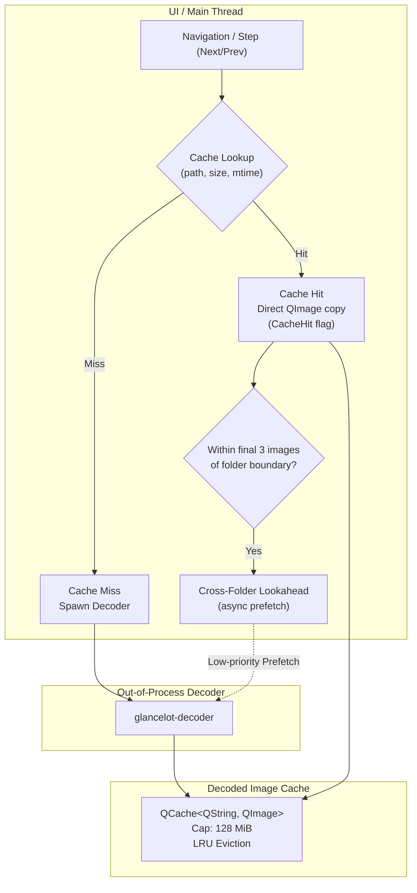

# CACHE-01 Task Packet: Revision-Validated Decoded Cache & Cross-Folder Lookahead

- **Task ID**: `CACHE-01`
- **Requirements**: `PERF-04`, `NAV-07`, `SYS-02`
- **Milestone**: M3
- **Priority**: 8
- **Owner**: Lead (Gemini lane)
- **Branch**: `agent/cache`
- **Worktree**: `.worktrees/cache`
- **Build Directory**: `build-cache`
- **Test Target**: `cache_tests` (`tests/cache_tests.cpp`)

---

## 1. Problem Statement & Motivation

Currently in `ViewerController`:
1. `cacheKey(file)` generates a key based on file path, size, and modification timestamp.
2. The controller instantiates `QCache<QString, QImage> cache{128*1024}` (128 MiB cost in KiB).
3. However, `decode(file, token)` explicitly bypasses cache lookups:
   ```cpp
   // Explicit opens are decoded again: coarse timestamps cannot prove content identity.
   // The bounded retained cache is reserved for a future validated-revision prefetch path.
   ```
   Every single image open or step, even when stepping back and forth between two images, launches a new `glancelot-decoder` child process, performs IPC handshake, shared memory mapping, and image copy.
4. There is no cross-folder asynchronous lookahead (`NAV-07`). When reaching the end of a folder, crossing to the next folder incurs the full latency of discovering the adjacent folder, enumerating its entries, and launching a cold decoder.
5. Memory admission accounting does not coordinate prefetch worker allocations and cache retention dynamically under memory pressure.

---

## 2. Requirements & Acceptance Criteria

### `PERF-04`: Bidirectional Decoded Cache with RAM/VRAM Limits
- **Actual Cache Hit Path**:
  - `decode(file, token)` performs a revision check: if `cache.contains(key)` where `key` reflects current file identity (path, file size, mtime epoch), immediately load the image from cache without spawning `glancelot-decoder`.
  - Sets `glancelot::perf::Flag::CacheHit` on the performance trace.
  - Exposes cache metrics (`decodedCacheBytes()`, `decodedCacheCount()`, `isLastDecodeCacheHit()`).
- **Bidirectional Stepping**:
  - Stepping Next then Previous hits the cache directly.
- **Revision Invalidation**:
  - Changing a file on disk (or modifying mtime/size) immediately causes a cache miss.
  - File watcher events (`fileChanged`, `directoryChanged`) and file operations (trash/delete) purge cached entries.
- **Memory Pressure & Eviction**:
  - Bounded cache capacity (default 128 MiB).
  - Cost calculated accurately based on `image.sizeInBytes()`.
  - Under memory pressure, LRU eviction automatically purges oldest entries.
  - Total admitted bytes (current image + worker transfer + staging + cache) never exceeds available system headroom.

### `NAV-07`: Cross-Folder Asynchronous Lookahead
- **Trigger**:
  - When viewing one of the final three eligible images in a folder (or first three when navigating backward), asynchronous lookahead evaluates the next (or previous) folder in the traversal tree.
- **Candidate Discovery & Prefetch**:
  - Identifies the next folder and its target entry.
  - Dispatches low-priority asynchronous prefetch to decode the candidate image into the validated cache when the main decoder is idle.
- **Cancellation & Stale Revision Discard**:
  - If the user reverses navigation direction, changes filters, or selects another folder/image, all pending lookahead tasks and prefetch results are cancelled and discarded.
  - Stale tokens never overwrite the current foreground image or selection.

### `SYS-02`: Robust Resource and Parser Boundaries
- Lookahead decoding remains strictly out-of-process via `glancelot-decoder` or isolated worker.
- UI/render thread never blocks on disk I/O or image decoding.
- Bounded shared memory and worker timeout (15s deadline).

---

## 3. Architecture & Data Structures



---

## 4. Verification Plan

1. **Unit & Integration Suite (`tests/cache_tests.cpp`)**:
   - `testCacheHitOnRevisit`: Open image 1 -> open image 2 -> open image 1 -> verify hit.
   - `testBidirectionalNavigation`: Forward step 1 -> 2 -> 3 -> 2 -> 1, verify hits on return.
   - `testRevisionInvalidation`: Modify file size/mtime on disk -> verify re-decode.
   - `testEvictionUnderPressure`: Fill cache beyond 128 MiB capacity -> verify LRU eviction.
   - `testLookaheadTriggerFinalThree`: Verify lookahead triggers when index >= count - 3.
   - `testLookaheadCancellationOnReversal`: Verify reversal cancels pending lookahead.
   - `testLookaheadCancellationOnFilterChange`: Verify filter toggle invalidates lookahead.
2. **Platform & Full Suite**:
   - Windows CTest: `scripts/build.ps1 -Test` (all 23 tests pass).
   - Linux Docker: `docker build -t glancelot-browser:main .` (all 23 tests pass).
