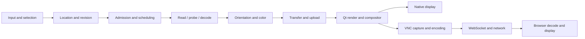

# Performance strategy and qualification plan

Planning date: October 17, 2026. Target: C++20 / Qt 6.8.3 Quick with the existing GPU canvas, native Windows and Linux, and the Linux Docker browser desktop. This is an implementation strategy, not benchmark evidence. All new numeric settings below are experimental starting points until measured. Existing [requirements](REQUIREMENTS.md) and [BUILD-PLAN performance contracts](BUILD-PLAN.md#11-performance-contracts-and-measurement) remain intact. The [feature inventory](FEATURE-OPPORTUNITIES.md) explains the workflows this work supports.

## 1. Optimize the complete experience

Optimize time to useful content, input-to-visible response, consistency, memory, power and recovery together. Maximum CPU utilization, decoder throughput or FPS alone is not the objective. A faster thumbnail sweep that stalls the selected image is a regression. Accurate pixels, deterministic traversal, cancellation and source safety are hard constraints.

Use three feedback loops: instrument and establish a repeatable baseline; change one diagnosed bottleneck; rerun correctness and the relevant end-to-end workload on the same machine. Retain a change only when its benefit survives repeats and does not move excessive cost to startup, memory, battery, another view or another platform.

Instrument every boundary. Attribute a request by generation, source revision, quality tier, pane and window. A pipeline span can overlap another; do not sum p95 stage values and label the result end-to-end p95. Native presentation and browser presentation require different evidence.

## 2. Repository baseline and immediate gaps

These are code/evidence observations at planning time, not measured bottleneck rankings:

| Area | Current implementation/evidence | Consequence for the plan |
| --- | --- | --- |
| Main decode | New decoder process per full-image request; probe/admission, shared-memory transfer and parent copy in [viewer_controller.cpp](../src/app/viewer_controller.cpp) / [worker/main.cpp](../src/worker/main.cpp) | Measure process launch, probe, color conversion and copy separately; trial persistent full-image workers only after lifecycle contracts are frozen. |
| Decoded cache | Controller retains a 128 MiB QCache but explicitly bypasses hits pending validated revisions | Implement CACHE-01's actual hit path and validation before claiming cached navigation performance. Retention without reuse can consume memory without improving latency. |
| Thumbnails | Two persistent workers, 256 queued jobs, 256-pixel maximum edge and 64 MiB memory cache in [thumbnail_service.hpp](../include/glancelot/thumbnail_service.hpp) | Keep bounded cancellation; unify admission and visible-item priority before increasing concurrency or adding disk caching. |
| Main-image admission | 256 MiB output limit; conservative four-buffer estimate plus current image/cache; 1 GiB allowance reduced by Windows available memory | Linux/cgroup limits, thumbnail workers, multiple windows, GPU allocations and render targets need coordinated accounting. Do not simply raise the image cap. |
| Canvas | QQuickRhiItem, 256 MiB image-texture cap, texture-size check, upload on image change in [image_canvas.cpp](../src/render/image_canvas.cpp) | Preserve upload reuse; account for target buffers and resize/compare multiplicity; test device limits and huge-image fallback. |
| Tree/grid | Two folder loads, 2,000 children per parent and 20,000 materialized tree rows; grid uses bounded delegates | Plan explicit continuation/paging beyond caps; profile enumeration/sorting/model publication, not just thumbnail rendering. |
| Docker | Ubuntu 24.04 amd64, Xvnc/Openbox/noVNC; xcb and software OpenGL; 1440x900 default; 512 MiB /dev/shm in [compose.yaml](../compose.yaml) | Profile whole-container CPU/memory and browser latency; shared-memory capacity is a separate limit and not a reservation. |
| Validation | Windows suite and Linux container build/tests recorded in [DOCKER-BROWSER.md](verification/DOCKER-BROWSER.md) | Full browser pixel interaction, Compose runtime, Unraid, ARM, hardware GPU, native Linux displays and ICC/HDR/high refresh are not qualified by that evidence. |

Evidence reconciliation is part of PLATFORM-01: some older capability/queue wording predates the Linux container build. Distinguish a Linux Qt build and software-rendered container run from a qualified native Linux GUI/package. Reconcile descriptions against the verification record; do not convert this document into new test evidence.

## 3. Measurement design and target budgets

### Reference environments

Record CPU model/topology, available CPU quota/affinity, RAM and memory limit, GPU/driver, storage/filesystem/mount, OS/kernel/compositor, Qt/codec/build versions, display size/DPI/refresh, power mode, thermal state and source hash. Preserve the existing R1-R4 definitions: R1 16 GiB/NVMe/iGPU; R2 8 GiB/HDD or throttled storage; R3 dGPU/mixed displays; R4 controlled SMB. Add the following separately named deployment cases:

| Case | Test scope |
| --- | --- |
| W-NATIVE | Windows physical desktop, Intel/AMD iGPU and available discrete GPU, NTFS local and SMB |
| L-WAYLAND / L-X11 | Native Linux on physical hardware, named compositor/driver, local and SMB/NFS mounts |
| C-CPU | Linux Docker host, software GL, fixed CPU/memory limits, browser on same LAN |
| C-GPU | Separately qualified container graphics/display path with real hardware rendering |
| U-ARRAY / U-POOL | Unraid photo array versus SSD pool; same container, desktop and client |
| WSL-EXT4 / WSL-NTFS | WSL Linux filesystem versus mounted Windows filesystem; host/VM limits recorded |
| REMOTE | LAN/Wi-Fi/high-latency profiles, explicit RTT, bandwidth, loss, browser and client device |
| ARM-TRIAL | Future native ARM64 build and codecs; unsupported until package and hardware evidence exist |

### Acceptance budgets

The first eight rows preserve selected existing budgets; the remaining rows propose additional gates. Adjust a target only with named hardware/workload evidence and a recorded requirement change, not by silently redefining the timer.

| Metric | Target | Measurement and caveat |
| --- | --- | --- |
| First correct 24 MP JPEG, R1 | p95 <=250 ms warm filesystem; <=750 ms controlled cold | >=50 fresh-process runs per condition; shell launch through presented oriented/color-correct pixels; <100 ms remains a stretch. |
| Cached navigation | p95 <=1 refresh interval; p99 <=2 | Cache must really hit and texture/source residency recorded; input through corresponding presentation. |
| Pan/zoom GPU time | p99 <=6 ms at 144 Hz; <=3.5 ms for qualified 240 Hz | Also measure total frame pacing; GPU timing alone does not prove a displayed frame or input latency. |
| Steady-state missed frame budgets | <0.1% on qualified workload | Ten-minute scenario; separate app, compositor and display misses; no universal zero-drop claim. |
| Initial 10,000-file grid content, R1 | p95 <=500 ms | First useful visible thumbnails, not completion of all enumeration/decoding; also measure time until stable sorted results. |
| UI under I/O pressure | No app-caused >50 ms stalls | No blocking filesystem/decode work on UI/render threads; include offline storage, mutation and metadata activity. |
| Native static idle | <1% of one logical CPU over 60 seconds, R1 | Normalize CPU definition; report whole viewer+workers and periodic watchers; no perpetual redraw. |
| Memory stability | Within admitted CPU/GPU budgets; no growth trend | 30-minute navigation/comparison/animation soak and worker churn; charge transient and shared allocations correctly. |
| First selection/focus feedback | Proposed p95 <=50 ms | Even when image decode is slow; distinguish immediate feedback from content-ready latency. |
| Cancellation acknowledgement | Proposed p95 <=50 ms UI response | Obsolete results become ineligible immediately; OS I/O completion can be unbounded, so report actual job/process reclamation separately. |
| Linux/container memory pressure | Proposed zero cgroup OOM kills in qualified workload | Explicit limit, reduced-quality fallback or actionable rejection; intentional OOM fault tests are a separate category. |
| C-CPU remote interaction | Proposed p95 <=150 ms on <=10 ms RTT LAN at 1440x900/30-update target | Warm navigation/pan workload; client input to browser-painted changed pixels; large uncached decode measured separately. |
| Remote session recovery | Proposed usable reconnect <=5 s after transport restoration | Preserve location and avoid duplicate actions; document server restart versus reconnect separately. |
| Multiple windows | Proposed foreground p95 regression <=10% within a fixed total budget | Run 1/2/4 windows with identical aggregate limits; background work yields, memory does not multiply unchecked. |

Frame intervals are approximately 16.67/8.33/6.94/4.17 ms at 60/120/144/240 Hz. These are total presentation intervals, not CPU and GPU budgets that may each consume the entire interval serially.

### Fixtures and sampling

- Generate 1 MP, 24 MP and 60 MP JPEG/PNG, panoramas, alpha-heavy and noisy images, all EXIF orientations, tagged/untagged/invalid profiles and corrupt/oversized headers. Add format-specific RAW/animation/HDR fixtures only with provenance and known expected output.
- Exercise 0, 1, 100, 10,000 and 100,000 mixed entries; flat/deep trees, long names, non-ASCII paths, folder-only views, links, permission failures and external changes. Large-folder timings include enumeration, sort and model publication.
- Replay forward browsing, reversals, jumping, fast grid scroll, split-pane resize, 2-up/4-up, simultaneous windows, repeated folder changes and background file operations. Record request-to-display correspondence and abandoned work.
- Distinguish fresh process, app-cache cold, filesystem-cache cold, NAS/server-cache cold and shader-cache cold. Never call an ordinary restart a cold-storage test. Use dedicated fixtures/hosts or a documented reboot procedure; do not routinely drop system-wide caches on the user's machine.
- Use >=50 startup samples and enough interaction samples to interpret tails (normally thousands); retain full distributions, medians, p95/p99, variance and sample count. Randomize A/B run order; separate warmup and profiler overhead from scored runs.
- Save baseline/changed commit, configuration, fixture manifest, raw results, trace files and correctness verdict. Store in an ignored local results directory; publish only explicit redacted evidence. No photos, private paths or telemetry are automatically sent anywhere.

## 4. Instrumentation and diagnostic tools

Add bounded local spans for startup/bootstrap, settings, root discovery, command receipt, directory enumeration, sorting, admission wait, source open/read, probe, decode, color/orientation, transfer/copy, GPU upload, render submission, presentation and cancellation. Include queue depth/age, active workers, outstanding retiring workers, cache hits by tier, stale drops, bytes read/copied/uploaded, memory reservations and error category. Trace quality tier and cache validation result rather than inferring a hit from fast duration.

Use monotonic timing and correlation IDs. Avoid raw path logging by default. A ring buffer and opt-in trace capture prevent logs from becoming a hot-path cost. Benchmark tracing off and on. UI status samples should be low frequency; do not trigger broad QML property updates for every internal event.

| Environment | Tools and their purpose |
| --- | --- |
| All Qt builds | Qt Creator QML Profiler for binding, creation, JavaScript and scene-graph work; QSG_INFO/Qt logging for actual renderer/backend; release-like build with symbols for stack attribution. Profiling configuration must not silently replace the scored release build. [Qt QML profiling](https://doc.qt.io/qtcreator/creator-qml-performance-monitor.html) |
| Windows | WPR/ETW capture and WPA for startup, CPU, disk, scheduling and memory; GPUView when queue behavior needs explanation. [Windows Performance Toolkit](https://learn.microsoft.com/en-us/windows-hardware/test/wpt/) |
| Windows presentation | PresentMon for available CPU/GPU/display frame metrics, correlated with app events. Missing or estimated input metrics are not physical input-to-photon proof. [PresentMon metric definitions](https://github.com/GameTechDev/PresentMon/blob/main/README-ConsoleApplication.md) |
| Linux | perf stat/record for CPU and call stacks; process RSS/PSS, page faults and allocation profiling for memory; targeted syscall/I/O tracing only when diagnosing a reproduced stall. [Linux perf tutorial](https://perfwiki.github.io/main/tutorial/) |
| Linux/container pressure | cgroup memory/CPU/I/O counters and pressure-stall information, sampled without hot-loop polling. Record quota throttling separately from app CPU demand. [cgroup v2](https://docs.kernel.org/admin-guide/cgroup-v2.html), [PSI](https://docs.kernel.org/accounting/psi.html) |
| Docker remote | Host/container process samples plus Xvnc CPU, bytes sent, desktop update cadence, WebSocket timing and browser performance traces; client and server clocks correlated or measure elapsed on one side. |

Do not benchmark with unrelated trace categories, synchronous logging, sanitizers or a debugger attached and then compare against uninstrumented release numbers. Use those tools for diagnosis/correctness, then rerun clean measurements.

## 5. Shared resource ownership and admission

### Memory accounting

Introduce one admission contract shared by full-image decode, thumbnails, metadata, prefetch, tiles, comparisons and file-operation buffers. Reserve before allocation; convert reservations to owned bytes at publication; release once on success, cancel, worker death or shutdown. Include limits across windows/processes using a lightweight local coordinator or conservative per-process shares with an explicit aggregate ceiling.

For a decoded image, `bytes = checked_stride * height`, where stride reflects format/alignment. RGBA8 uses at least four bytes per pixel; RGBA16F eight. A 24 MP RGBA8 buffer is about 91.6 MiB; 60 MP is about 228.9 MiB. Four 60 MP buffers consume about 915.5 MiB before current pixels, cache, worker overhead or GPU resources. These calculations explain why copy count matters as much as cache size.

Maintain separate ledgers for CPU decoded pixels, worker scratch, shared transfer, retained cache, thumbnail/model data, GPU textures/staging/render targets and deployment overhead. Account physical ownership once when QImage shares storage; detach/copy requires a new reservation. For shared CPU/GPU memory, do not assume VRAM is an independent free pool.

Define total admitted memory no larger than the minimum of the user cap, safe OS-available headroom and effective container/job limit minus measured non-image overhead and safety reserve. Include ancestor cgroup constraints where applicable; unlimited/unknown is not zero. Start conservatively when querying fails. A single static fraction of host RAM is insufficient inside a constrained container. Docker documents separate CPU/memory controls and the absence of limits by default. [Docker resource constraints](https://docs.docker.com/engine/containers/resource_constraints/)

Start testing cache policy with a reclaim threshold around 80% of the app budget and a lower recovery threshold around 65%; these are tuning hypotheses, not shipped defaults. Preserve space for one foreground decode and its maximum validated scratch. Never promise an exact image can open if its measured peak cannot fit; provide a bounded preview or a clear unsupported/resource message. Increasing a cap must not bypass dimension/overflow/parser checks.

### Pressure response and ownership failure cases

Evict speculative decoded images, hidden thumbnails and inactive-window GPU textures first; pause metadata/prefetch next; lower fit-preview resolution where clearly labeled; then refuse new allocations while preserving the last valid image. Do not repeatedly evict/redecode the same active working set. Use hysteresis and a cooldown.

Test worker crash after reserve, cancel during transfer, late completion after a newer selection, device reset, shared-memory creation failure, two windows requesting the same source, cache detach and shutdown with active I/O. Inspect actual high-water memory alongside ledgers; an accounting assertion alone cannot detect codec-internal allocations. Where possible enforce worker limits at the OS/process boundary, keeping current sandbox-enforcement gaps explicit.

### CPU and queue budgets

Derive effective CPU capacity from OS availability, affinity/cpuset and quota, not just hardware_concurrency. Begin with one foreground decode lane and one background lane on constrained systems; trial two background workers on ordinary desktops and larger counts only when measured. Account codec-internal threads and software-rasterizer/remote-encoder threads in the same contention model. Avoid permanent affinity pinning or realtime priority as a default.

Queue order: explicit current selection; visible comparison panes; visible grid thumbnails; imminent next/previous preview; offscreen prefetch; metadata/search/disk-cache maintenance. Add aging so legitimate lower-priority work completes. Coalesce identical source/revision/size requests and replace obsolete queued selections before starting a worker. Bound both queue length and queued-byte estimates; reject or defer with useful state instead of dropping silently.

## 6. Filesystem, enumeration and storage scheduling

1. Keep all directory scans, existence/stat checks on potentially remote paths, recursive work and metadata reads off UI/render threads. Audit convenience calls such as path canonicalization, QFileInfo and shell icon lookup as well as explicit scans.
2. Enumerate in cancellable bounded batches. Publish small model deltas on the UI thread with a time budget; build sort keys off-thread. Avoid one signal or model reset per file. Maintain an identity-to-row index for reveal/selection instead of repeatedly scanning every row.
3. Establish names/types first, then cheap filesystem fields, then expensive image/EXIF fields only when requested. Share a directory snapshot across tree/grid/filmstrip where semantics permit. Do not sort by capture time by eagerly decoding every source on every visit.
4. Resolve the conflict between partial arrival and stable sorting: label incomplete results, batch merges, preserve identity/scroll anchors, and publish the definitive order once known. Support continuation beyond current caps without hiding entries. Do not make the first thumbnail wait for all expensive metadata.
5. Maintain storage-specific queues and measured service times. Local SSD, spinning disk and network share are different scheduling domains; a slow NAS must not consume every slot needed by local selection.
6. Watch current folders and a bounded set of relevant sources, debounce change bursts, and recover after overflow/rename/replacement. Network event delivery may be absent; offer explicit refresh and conservative bounded refresh where needed. Changes invalidate source revisions, not only paths.
7. Treat cancellation as stopping new work and rejecting obsolete publication. A blocked kernel/network syscall may not return immediately. Bound stuck jobs, reserve a route for unrelated storage, expose the stalled source, and qualify process isolation where cancellation requires termination. Never spawn unlimited replacement threads/processes.
8. Schedule copy/move/hash/search jobs below interactive reads with bounded chunks and explicit pause. Do not disable verification/durability to make mutations look faster. Folder deletion must not trigger synchronous recursive recounting in every view.

| Storage class | Initial experiment | What decides the final policy |
| --- | --- | --- |
| NVMe / SATA SSD | One foreground plus 1-3 background read/decode jobs | Foreground p95, actual queue time, CPU saturation and bytes wasted after cancellation |
| HDD / USB rotational | One sequential reader, minimal cross-folder lookahead | Seek thrash, spin-up delay, reversal behavior and foreground latency |
| SMB / NFS | One foreground plus one speculative job; batch metadata and cache validated listings | RTT, retransmits, server queueing, stale attributes and disconnect recovery |
| Removable / intermittent | Conservative queue and explicit mount identity | Unplug, remount under same path, permission changes and retry storms |
| Unraid array | Small bounded lookahead; avoid probing dormant unrelated disks | Spin-up and mover/parity activity measured separately from app work |

Manual overrides should be reversible and per source class/location. Do not change NAS, filesystem, antivirus or host caching policies automatically.

## 7. Decode, cache and image pipeline

### Fast first useful image

Perform settings/theme/window bootstrap in parallel with a single explicitly requested source, while deferring optional metadata, full root discovery and secondary panes. An explicit shell-open must not await restored missing folders. A lightweight preview pipeline should select embedded preview or codec-scaled decode where proven, then refine to needed resolution. Preserve orientation, color semantics, dimensions and view transform at every swap.

Measure launch/probe cost before replacing one-shot full-image workers. A persistent pool experiment must preserve crash isolation, hard deadlines, bounded lifetime/recycle policy, per-request reset and generation checks. Avoid concurrent full/preview decodes that double memory for negligible latency gain. Validate each codec's actual scaled/region behavior; a small output request does not prove a small internal allocation.

### Make cache hits safe and useful

- Key by source identity/revision, decode tier, requested size bucket, orientation and color/decoder version; include archive-container revision later. Path and coarse mtime/size alone do not prove unchanged content.
- Use file identity and change generation where reliable, plus conservative revalidation on weak filesystems. Reopen/redecode when uncertain. Full-file hashing on every open would defeat many cache hits; hash only where needed and under I/O admission.
- Separate tiny preview, decoded CPU and uploaded GPU tiers. Cache a proven working set, with directional lookahead and a reverse buffer. Report hit rate together with bytes retained, decode time saved and wasted speculative work.
- Speculate by velocity and known boundary distance; cancel direction reversals immediately. Bound retries and lifetime. Preserve original NAV-07 last-three-images trigger as the target, while explaining when budget/storage prevents readiness.
- Coordinate thumbnail requests across grid and filmstrip; use a few DPR-aware size buckets rather than a unique decode for every slider position. Hidden panes release requests; rapidly resized panes debounce higher-resolution requests without delaying UI layout.
- Optional disk thumbnails are a later extension to the current memory-only contract. Use a disposable versioned cache outside originals, byte quota/LRU, atomic writes and invalidation; local SSD preferred. Clearing it must not remove ratings/settings. Do not persist full private images by default merely to improve a benchmark.

### Reduce copying without weakening ownership

Instrument codec output, color conversion, shared-memory copy, parent copy and texture staging. Reuse immutable buffers/pools within bounded ownership. Trial a safely owned mapped-transfer buffer or direct decode destination only where the codec/Qt lifetimes support it; acknowledge transfer after all consumers release it, handle worker death and stale results, and never call it zero-copy without tracing the GPU upload too.

Use optimized codec implementations and runtime CPU dispatch only after pixel/format qualification. Do not ship binaries requiring the developer machine's ISA. Cache reusable color transforms by profile/intent/precision; keep metadata parsing isolated and bounded. Lossy shortcuts, approximate color or reduced bit depth must not silently enter exact-inspection mode.

## 8. GPU, Qt Quick and workspace responsiveness

Keep rendering event-driven. Pan/zoom/rotation updates transforms; it should not trigger source decode, full CPU resampling or texture re-upload. Upload once per revision/quality tier, reuse samplers/pipelines, and bound staging work per frame. Avoid GPU readback in normal viewing; diagnostics/histograms should have separate async paths.

Budget pane render targets by physical pixels: width * height * DPR squared * bytes per pixel * buffer/sample count. Multiple previews, MSAA and full mip chains add cost; a complete 2D mip chain is approximately another one-third of the base texture. Do not enable MSAA for an ordinary image quad without a measured quality need. Preserve alpha and accurate resampling.

QQuickRhiItem renders to an offscreen target which is then composited. Measure that cost before considering a deeper scene-graph integration. Keep the pinned private QRhi surface isolated and test each backend. The Qt software scene-graph adaptation is not a functioning substitute for this canvas; software OpenGL is a distinct route. [QQuickRhiItem contract](https://doc.qt.io/qt-6.8/qquickrhiitem.html)

For large images, progressively decoded previews and bounded tiles are preferable to raising every allocation cap. Validate texture-size limits, format support and memory before upload. Evict inactive textures before current ones; rebuild from CPU/source state after device loss without resurrecting an obsolete generation.

Apply QML profiling to bindings, delegate construction and text layout. Keep list/grid delegates small, avoid offscreen models spawning requests, batch role changes, lazy-load expensive panes, and preserve focus/state when unloading. Avoid redundant opacity layers/effects and full-window damage from tiny status updates. Qt documents asynchronous models, batching and lightweight delegates as performance considerations. [Qt Quick performance guidance](https://doc.qt.io/qt-6.8/qtquick-performance.html)

For movable panes: drag a lightweight placement indicator where helpful; update geometry at a bounded cadence; cancel thumbnail detail upgrades during continuous resize; save layout after settled changes, not every pointer event. Freeze prevents geometry changes but must not disable viewing. Combined grid/preview mode shares one scheduler and source model, not independent duplicated decode pipelines.

Keep the normal threaded render loop unless platform evidence calls for a fallback. Measure GUI synchronization, render work and compositor pacing separately; test swapchain/renderer changes at application startup rather than toggling active resources unsafely. Actual backend selection and render-loop diagnostics are available through Qt scene-graph configuration. [Qt renderer](https://doc.qt.io/qt-6.8/qtquick-visualcanvas-scenegraph-renderer.html)

## 9. Native Windows strategy

### Rendering and display

1. Establish the actual shipped default backend and GPU adapter using logs. A/B D3D11 and D3D12 on the same supported hardware; qualify Vulkan/OpenGL only where the build and drivers support them. The existing D3D12 target does not justify declaring it fastest without measurements.
2. Test Intel/AMD integrated and available discrete GPUs, including hybrid laptops. Record GPU switching, shared/dedicated memory and power cost. Do not force a discrete GPU for a static image when the integrated path meets latency/quality goals.
3. Offer a restart-required renderer override and a recoverable default if a chosen backend fails. WARP can be evaluated as a compatibility path, with capability/throughput labeled; it is not hardware acceleration. Qt documents the Windows backend and software-rasterizer selection mechanisms. [Qt Windows graphics](https://doc.qt.io/qt-6.8/windows-graphics.html)
4. Validate 100/125/150/175/200% DPI, mixed monitors, maximize/fullscreen transitions, occlusion/minimize, docking and suspend. Preserve the image-pixel-to-physical-pixel invariant. Avoid reallocating large targets for every intermediate resize event.
5. Measure display pacing with and without overlays, split panes and an active secondary window. Verify output-profile transitions and retain SDR warnings until physical color tests pass. RDP/virtual-display results are a separate profile.

### CPU, startup and files

6. Use Release builds with optimized codec paths and symbols retained outside the portable package. Compare link-time optimization and representative profile-guided optimization only after baseline traces identify a useful benefit; rerun malformed-input and pixel tests.
7. Profile DLL/plugin discovery, QML initialization, theme catalog parsing, worker process startup and Windows file reputation/security scanning. Reduce unnecessary loads and package only needed runtime modules; never recommend disabling antivirus or adding broad exclusions as a performance feature.
8. Use local Windows storage for native cache/settings/build artifacts. Open source files with non-exclusive access that permits external replacement/deletion as required. Benchmark NTFS, UNC and mapped-drive cases separately; drive letters are not proof of local SSD storage.
9. Keep network path probes and Explorer/shell integration off the UI path. Fetch expensive shell icons only when requested or cache bounded generic icons. External tools launch with argument arrays, not interpolated shell commands.
10. Give background decode/hash/metadata work lower contention priority while protecting UI/render progress. Evaluate OS background efficiency policies only for genuine background tasks; never set realtime process priority or pin all work to one core by default.
11. Observe OS/process memory pressure and GPU budget changes. Evaluate process/job restrictions for worker containment without breaking cancel/exit. Respect multiple independently launched windows under one aggregate resource policy.
12. Trace filesystem notifications and external atomic-save behavior; use identity-aware invalidation, bounded debounce and explicit retry. Test indexing/security-scan contention with default system protections intact.

Windows qualification: baseline and changed builds on R1/R2/R3, native portable package without development Qt on PATH, clean-machine launch, generated files on local/SMB storage, keyboard/mouse/trackpad, 30-minute soak and sleep/GPU recovery. WPR/WPA explains CPU/I/O stalls; PresentMon/GPUView explains presentation queues; physical equipment is needed for display-sensitive claims.

## 10. Native Linux strategy

### Graphics and compositor matrix

1. Test Wayland and X11 as distinct targets, recording desktop/compositor and driver. Include Mesa Intel/AMD and proprietary NVIDIA when available. XWayland is another configuration, not interchangeable evidence for native Wayland.
2. Compare Vulkan and OpenGL with the pinned Qt build. Record actual renderer and fallback; verify required Wayland/xcb plugins are packaged. Unsupported backend configuration must fail clearly or recover through a documented restart path.
3. Keep compositor frame scheduling intact; do not ship blanket forced-vsync-off, basic-loop or desktop-effects overrides. Profile app work versus compositor pacing before changing the render loop.
4. Test fractional scaling, monitor moves, refresh changes, fullscreen and suspend. Window placement, always-on-top and screen capture capabilities differ by environment; detect rather than promise unsupported behavior. Native ICC/HDR needs separate physical qualification.

### CPU, memory and filesystems

5. Read available memory and cgroup constraints; size admission for the process's actual environment. Use PSI and cgroup memory events as pressure signals where available, with a conservative fallback. cgroup v1 or delegated/unreadable controllers need explicitly tested fallback behavior.
6. Profile CPU stacks, faults, context switching and blocked time before selecting allocator, thread-count or SIMD changes. Evaluate GCC/Clang optimized builds and LTO/PGO with reproducible compiler flags; ship a portable CPU baseline and runtime dispatch for faster paths.
7. Compare ext4/btrfs/XFS and relevant network mounts where deployed; record actual filesystem/cache/compression settings instead of attributing all differences to Linux. Keep snapshots, compression and CoW policy under the system owner's control.
8. Bound inotify/watch usage; handle watch failure/overflow and atomic replacement without global polling. Large-tree browsing must not create one watch per file. Polling fallback, where needed, is limited to active locations and pauses when idle/offline.
9. Do not assume mmap is universally faster or safe under source truncation; compare buffered sequential reads and mappings only on validated workloads with robust replacement handling. Never change mount options, I/O scheduler or kernel limits automatically.
10. Protect render/UI scheduling from decode pools and codec threads. Measure on battery as well as AC; respect system power policy. Background I/O hints are experiments, not universal fixes, especially on remote filesystems.
11. Test file names, case semantics, permissions, links, deleted-open files and removable media. Cache identity must include the mounted source; a new disk at the same path is not the old revision.
12. Qualify packaging in supported distribution environments with all Qt plugins and codecs present, then actual desktop launch. An offscreen CTest pass cannot prove GPU presentation, dialog integration or accessibility.

Linux qualification: functional tests and native UI runs on named Wayland/X11 desktops, native output screenshots for UI layout, CPU/GPU traces, storage fault tests, Orca/keyboard checks and physical-display evidence where claimed. Keep software/headless tests as a fast separate correctness lane.

## 11. Docker and browser-desktop strategy

### Treat the deployment as a pipeline

The current route is Qt -> software OpenGL -> virtual X display -> Xvnc encoding -> websockify -> browser. A fast server-side render can still produce slow browser interaction. Measure startup of each supervised process, authenticated connection, first desktop, first useful image and reconnect separately. HTTP 200 from noVNC is only web-service health; add a separately scoped desktop/worker functional probe.

Keep image content in read-only bind mounts by default; settings and optional cache use explicit persistent storage. Container writable layers are not the intended high-write cache location. Docker volumes avoid relying on writable-layer storage and persist separately from the container. [Docker volumes](https://docs.docker.com/engine/storage/volumes/)

### Resource profiles to benchmark

These proposed profiles are experiment inputs, not Compose changes or supported-size promises. App image budgets must fit inside the stated container limit after measuring Python/Openbox/Xvnc/Mesa/Qt overhead.

| Profile | Initial envelope | Quality / scheduling experiment |
| --- | --- | --- |
| C-CPU constrained | 2 effective CPUs, 2 GiB limit, 1280x720 | One foreground decode, one background worker, 15/30 update-cap comparison, small visible-thumbnail overscan; large sources may require scaled preview. |
| C-CPU balanced | 4 effective CPUs, 4 GiB limit, 1440x900 or 1920x1080 | One foreground plus up to two background workers only if latency improves; compare 30/60 update caps and compression cost. |
| C-GPU trial | Explicit GPU path, 4+ effective CPUs, 4-8 GiB limit | Start at 1080p, prove hardware renderer then evaluate 4K; reserve CPU for VNC encoding/browser transport. |

Apply a CPU quota/memory limit only with visible documentation and a measured allowance inside it. Record CPU throttling, memory.current/peak/events and whole-container CPU; decoder-local RSS alone misses the renderer/encoder. `/dev/shm` capacity is a separate ceiling: determine the Qt IPC backing in the actual build, track concurrent transfer segments and test exhaustion. The present 512 MiB setting is not a guarantee that every large-image/multiwindow workload fits.

No privileged container, host-wide IPC, or disabled sandbox is required for ordinary tuning. Preserve the existing unprivileged user, dropped capabilities, no-new-privileges and read-only source mount. If future file operations are enabled for an explicitly writable mount, keep unavailable-trash and cancellation semantics intact; do not remount the user's media writable as part of performance work.

### Software rendering and remote encoding

Reduce avoidable damaged pixels: eliminate ambient animation, polling HUD redraws and large translucent effects; hide expensive inactive panes and idle workers. Reducing desktop pixels can matter more than increasing decoder workers. 3840x2160 contains 6.4 times as many pixels as 1440x900, before compression/content effects. Browser scaling alone does not reduce the server render workload.

Benchmark update cap, compression and JPEG quality together on text, noisy photographs, smooth gradients and fast pans. High compression may save bandwidth while costing server CPU; low quality can hide image detail. Keep a high-quality still-inspection option and clearly label the remote path's limitations. The noVNC API exposes separate compression, quality, local scaling and session-resize controls; capability and packaged-version checks are required. [noVNC API](https://novnc.com/noVNC/docs/API.html)

Xvnc's frame-rate setting limits update delivery; it does not guarantee the application or client can maintain that rate. Its documentation also describes framebuffer comparison and newer GPU-render-node support. Inspect the **installed Ubuntu package's** version/help before using options from current upstream manuals. [TigerVNC Xvnc manual](https://tigervnc.org/doc/Xvnc.html)

Use backpressure/coalescing so obsolete frames cannot accumulate into seconds of lag. Measure WebSocket queued bytes, browser decode/paint, client CPU and bandwidth. Test foreground/background browser tabs, high-DPI clients, fullscreen and reconnect. Avoid automatically adding another compression layer without measuring CPU and latency. Reverse proxies need working WebSocket forwarding; security settings remain intact during benchmarks.

### Optional GPU path: a gated experiment

1. Inventory host GPU, driver, device-node permissions and container libraries. For Intel/AMD, trial a minimal render-node mapping only when the display stack supports it; for NVIDIA, verify the installed Container Toolkit and required graphics/display capabilities. GPU compute visibility alone is not proof of usable graphics. [NVIDIA container capabilities](https://docs.nvidia.com/datacenter/cloud-native/container-toolkit/latest/docker-specialized.html)
2. Remove the forced software-GL setting **only in a separate experimental profile**. Verify actual GL/Vulkan vendor/device and Qt backend from inside the display session, not just device files or nvidia-smi.
3. Check whether the packaged Xvnc supports the needed acceleration path; a newer upstream `rendernode` option must not be assumed present. If not, compare a qualified alternative display/capture architecture as a separate project. Do not claim that `/dev/dri` passthrough alone accelerates the current desktop.
4. Measure framebuffer readback/copy and VNC CPU encoding. GPU rendering can improve one stage while adding transfer cost; it does not automatically enable hardware video encoding in noVNC.
5. Retain the existing software profile as fallback. Add clear failure diagnostics and no automatic driver installation or host changes. Qualify crash/restart/device loss and confirm no source writes.

A hardware video/WebRTC streaming alternative is conditional later work: measure still-image fidelity, text clarity, latency, browser support, deployment complexity and licensing before replacing VNC. Native GPU capability, physical 1:1, ICC and HDR remain separate from remote stream quality.

### Container build, storage and lifecycle

Keep multi-stage builds, cache dependency/toolchain layers and pin tested dependency provenance. Reduce runtime image size only after dependency/plugin scanning and clean-runtime tests; shipping the whole Qt tree is a candidate size improvement, not automatically the dominant startup problem. Record image build/pull/unpack time separately from application first-image latency.

Keep settings atomic and cache disposable across recreation. Test graceful stop, kill/OOM restart, stale X-lock recovery, read-only photos, disk-full config/cache, simultaneous clients and shutdown while decoding. Do not shorten the stop grace period merely to produce a faster stop number if it loses state. The existing settings-reader retry is a mitigation with unresolved root cause; add stressed durability testing rather than suppressing checks.

## 12. Unraid and NAS strategy

Measure at least three paths: native viewer over SMB; container reading a host bind mount; and the same container with fixtures on an SSD pool. Record whether the dataset is on array disks, a pool, a user-share path or a remote mount, plus spin state, mover/parity/scrub activity and client network conditions.

Place settings and disposable thumbnails on a suitable persistent SSD pool when available and deliberately configured. Keep source media where the user intends it; do not move originals just to improve a benchmark. Respect disk spin-down: avoid recursive startup scans, probing all favorites or large speculative cross-folder reads that wake unrelated disks.

For eligible configurations, test Unraid exclusive shares against the ordinary user-share path; version and share conditions matter. Unraid introduced exclusive shares that bypass the FUSE user-share layer. This is a benchmark candidate, not a blanket recommendation to bypass user shares or rewrite mount paths. [Unraid exclusive-share documentation](https://docs.unraid.net/unraid-os/release-notes/6.12.0/)

Never mix disk/pool paths and user-share aliases for the same source inside file-operation logic without resolving their identity; deduplicate aliases and avoid dangerous self-copy/move behavior. Test permissions/UID/GID, available trash, mount boundaries and read-only error reporting. Configure cache quotas and free-space fallback so a full pool cannot break normal viewing or settings persistence.

Use small per-device concurrency on spinning arrays, prioritize interactive reads and benchmark during and outside normal maintenance. Do not automatically pause parity checks/mover, change share settings or spin policies. Offer a background-work pause in the app. Validate the eventual Compose configuration on the actual Unraid host; the existing WSL Docker evidence does not qualify it.

## 13. WSL, Docker Desktop, virtual machines and other systems

For Linux builds/tests in WSL, compare fixtures/build/cache on the Linux filesystem against `/mnt/c` explicitly. Microsoft recommends storing files on the filesystem of the tools being used for best performance. Native Windows measurements should remain on native Windows paths. [WSL filesystem guidance](https://learn.microsoft.com/en-us/windows/wsl/filesystems)

In Docker Desktop, record host memory pressure, VM CPU/memory allocation, virtual-disk location and Windows-to-Linux bind mounts. A fast Linux container on ext4 does not predict a container reading millions of files through a host mount. Native Linux GPU, WSLg and Docker browser display paths require separate test cases. [Docker WSL backend](https://docs.docker.com/desktop/features/wsl/)

Use VMs/CI for builds, functional tests, packaging and failure injection. Record virtual CPU quota, steal/contention, graphics adapter and filesystem bridge. Never infer physical-monitor color, true native refresh pacing or bare-metal I/O throughput from them. RDP and other remote-native sessions also get their own renderer/transport profile.

ARM64 is a separate feasibility lane: compiler/Qt/codec availability, NEON/runtime dispatch, alignment, memory limits, thermals and actual packaging first; no x86 emulation benchmark is an ARM performance claim. macOS is outside the present target scope; a future port would need its own Metal, color, filesystem, power and packaging qualification. Headless servers use the tested software-rendered desktop or explicit non-viewing tooling; do not promise a canvas without a functioning graphics route.

## 14. Power, adaptive profiles and configuration UX

Expose a small set of understandable profiles: Auto, Battery, Low memory, Fast browsing and Remote. Display effective limits and a short explanation of tradeoffs. Advanced controls may expose memory ceiling, speculative I/O, background workers, cache location and renderer override; distinguish immediate changes from restart-required options. All values need validation and a safe reset.

Auto starts conservatively, samples workload/pressure slowly, and changes one dimension at a time with hysteresis. Battery mode reduces speculative decode, animation cadence and background metadata while keeping direct interaction responsive. Low memory emphasizes scaled previews and reclaim; Fast browsing admits larger validated caches within the same safety envelope. Remote reduces rendered pixels/damage and adjusts transport independently of source decode quality. Exact-inspection mode never silently becomes a lossy preview.

Suspend hidden-window rendering, unnecessary timers and idle thumbnail work. Preserve correct animation time on resume without decoding every missed frame. Test minimized/occluded windows and disconnected clients for near-idle behavior. Measure energy per browsing task or average package/system power on hardware that exposes reliable counters; do not claim energy savings from lower CPU percentage alone.

Store renderer/profile decisions per appropriate machine/window scope; portable preferences must survive moving to a weaker GPU or different OS. Failed manual overrides recover to a usable launch. Diagnostics are local, optional and redact paths by default. A tuning control should report what is effective, including when a container limit overrides the user's request.

## 15. Build and release optimization

Keep the Qt version, private QRhi headers, plugins and shader compiler aligned. Verify the actual 6.8.3 runtime in packages; a minimum-version CMake match alone is not provenance. Record compiler, flags, codec versions, ISA baseline, build type and dependency hashes. Use optimized builds with separate symbols, Qt's QML module/shader build pipeline, and test packages without developer environment variables.

Evaluate LTO/PGO, dependency trimming, codec SIMD, allocator changes and static/dynamic linking choices as separate experiments. Require measurable startup/throughput/memory wins and unchanged correctness; avoid fast-math or lower precision where it changes color/sampling semantics. Representative PGO workloads must include mixed images, startup, grid scroll, cancellations and remote constraints rather than one favorable file.

Separate build-speed improvements from runtime performance: incremental builds, cached dependencies, bounded parallel build jobs and smaller images improve development/deployment but do not demonstrate faster viewing. Do not remove tests from Docker builds to call the runtime faster. Toolchain or codec upgrades are manual, reviewed dependency changes, not automatic application updates.

## 16. Delivery work packages and dependencies

These are proposed implementation packets. They map onto existing tasks rather than being silently added ahead of the approved feature queue. The lead freezes shared APIs and creates isolated worktree/branch/build assignments when a packet is promoted. New headers/resource contracts, root CMake/configuration and queue edits remain lead-owned.

| Packet | Map / prerequisites | Deliverable and exit evidence |
| --- | --- | --- |
| PERF-MEASURE | SYS-05; start before tuning work | Bounded spans, fixture manifest, stage/result schema and baseline replay; demonstrate cache miss/hit distinction, clock semantics and profiling overhead. |
| PERF-RESOURCE | CACHE-01 / IO-01; PERF-MEASURE | Shared CPU/GPU/transfer/worker accounting and effective OS/container limits; pressure, cancellation, crash and multiwindow tests with measured peaks. |
| PERF-ENUM | FILE-GRID-01 / PLATFORM-01; PERF-MEASURE | Bounded incremental listing/sort/publication, identity lookup, visible continuation and remote failure handling; 10k/100k mixed-folder traces. |
| PERF-CACHE | CACHE-01; PERF-RESOURCE | Validated hit path, bidirectional lookahead, revision invalidation and pressure eviction; cached versus uncached evidence including same-size/coarse-timestamp replacement. |
| PERF-SCHED | IO-01; PERF-RESOURCE, PERF-ENUM | Storage-aware admission, coalescing, fairness and background mutation/search limits; SSD/HDD/SMB/NFS reversal/disconnect tests. |
| PERF-DECODE | DECODE-01 follow-up / FORMAT-02; PERF-RESOURCE | Measured preview/full pipeline, worker reuse experiment and copy reduction; malformed inputs, stale results, timeout/kill/recycle and pixel oracle. |
| PERF-THUMB | BROWSE-01 follow-up / FILE-GRID-01; PERF-SCHED | Shared visible thumbnails, DPR size buckets, hidden-pane cancellation; scrolling/resize traces and bounded queue/delegate/cache counts. Optional disk cache is a separate contract extension. |
| PERF-RENDER | CANVAS-UI follow-up / PANES-01; PERF-RESOURCE | Reused textures/pipelines, bounded targets/staging, event-driven redraw and GPU-loss recovery; native 60/144 Hz evidence and conditional 240 Hz. |
| PERF-WINDOWS | PLATFORM-01; PERF-MEASURE, PERF-RENDER | D3D11/D3D12 comparison, DPI/adapter/packaging/profile matrix and ETW/presentation traces on physical Windows machines. |
| PERF-LINUX | PLATFORM-01; PERF-MEASURE, PERF-RENDER | Native Wayland/X11 plus supported driver/backend matrix, effective limits, watcher stress and deployable package; separate headless evidence. |
| PERF-CONTAINER | DOCKER-BROWSER-01 follow-up; PERF-RESOURCE, PERF-MEASURE | CPU/memory/shm profiles, useful health checks and lifecycle/storage testing; actual Compose and Unraid runs with explicit limitations. |
| PERF-REMOTE | PERF-CONTAINER, PERF-RENDER | Client/server timing, resolution/compression/update experiments and reconnect/backpressure tests; GPU route remains conditional until proven. |
| PERF-POWER | UI-SETTINGS-01; PERF-SCHED, PERF-RENDER | Effective profile controls, idle/suspend behavior and energy/resource comparisons; no quality ambiguity or override lockout. |
| PERF-BUILD | PLATFORM-01; PERF-MEASURE | Reproducible optimized package, symbols/provenance and A/B LTO/PGO/codec experiments; clean-machine and correctness tests. |
| PERF-SOAK | SYS-05 / SYS-06; all promoted relevant packets | Integrated 30-minute minimum soak, fault matrix, no-source-write hashes, regression comparison and independent review on the delivered commit. |

The first bottleneck-focused implementation cycle should be PERF-MEASURE -> PERF-RESOURCE -> PERF-CACHE/PERF-ENUM -> PERF-SCHED/PERF-THUMB, with rendering/platform work guided by traces. Do not turn every experiment into a long prerequisite for a simple UI improvement. Existing runtime gaps are risk-ranked hypotheses until measured.

## 17. Verification, rollout and stopping criteria

### Correctness before performance claims

Run `scripts/build.ps1 -Test` for Windows changes and the documented CMake/CTest path in [BUILDING.md](../BUILDING.md) for Linux. Add tests only for meaningful resource, failure or behavioral contracts. Use generated media and hash originals before/after viewing. Test source changes, stale generations, malformed messages, overflow, timeout/cancellation, worker crashes, device loss, disconnected mounts, watcher overflow, full disks and config contention.

UI verification covers compact/wide layouts, combined panes, themes, keyboard/text/modal precedence, focus loss, high DPI and large text. Native render tests supplement offscreen tests. Browser automation must exercise actual canvas pixels/input and compare with server state; a noVNC page load alone does not demonstrate interaction.

### Regression policy

1. Preserve the previous baseline package and configuration. Capture at least two repeat batches before concluding a performance regression or gain; use paired workloads and report variance/confidence where meaningful.
2. Flag >10% regressions on dedicated hardware as the existing plan requires. Add an absolute threshold appropriate to the metric to distinguish timer noise, but never use it to hide a hard-budget breach. Investigate failed correctness/resource gates regardless of timing.
3. Compare p50/p95/p99, peak memory, queue age, stale/wasted work, idle CPU and quality together. Report cache-cold and cache-warm separately. A 2x throughput improvement with worse interactive p95 is not an accepted interactive optimization.
4. Keep experiments behind internal switches or reversible configuration until independently reviewed; do not expose every profiling knob as a permanent setting. Roll back the policy/backend choice when failure or latency worsens.
5. Integrate serially, rerun checks on the integrated commit, record exact commands/output and platform limits, then mark the relevant task done. A review of an earlier commit cannot approve unreviewed later runtime changes.

### Evidence package

For every qualified platform/profile, store: commit and build manifest; machine/deployment description; fixture hashes and scenario; exact command/configuration; unmodified timing samples; stage trace; actual backend/device; memory/queue peaks; correctness/source-hash results; screenshot/video where useful; reviewer; and explicit unverified gates. Redact private content/paths before sharing.

Done means the named workflow meets the retained budgets without violating correctness, quality, source safety or resource bounds on its declared environment. Stop tuning when the measured limiting stage meets its budget and another stage dominates, when improvements fall within noise, or when maintenance/compatibility costs exceed the benefit. Reopen only for a reproduced workload, new platform, material feature change or demonstrated regression.

## 18. Decisions and unresolved feasibility gates

| Decision / gate | Current planning stance | Evidence needed to change it |
| --- | --- | --- |
| Global budget versus independent caches | Shared admission is required for combined panes and multiple windows | Reservation/ownership design, process coordination and actual high-water measurements |
| Persistent full-image workers | Experiment after launch-cost measurement | Faster end-to-end result with bounded memory/lifetime and equal failure isolation |
| Default renderer per OS | Keep current proven route; benchmark candidates | Same-machine pacing, quality, power, startup and recovery matrix |
| Disk thumbnail cache | Optional later extension | Repeat-visit benefit, privacy/storage policy, invalidation and measured write cost |
| Huge-image support | Preview/tiles before higher caps | Codec-specific peak memory and tile/region capability evidence |
| Container GPU acceleration | Conditional separate profile | Actual hardware rendering, complete capture/encode path and net client-visible benefit |
| Physical color/HDR/high refresh | Unverified where hardware evidence is absent | Calibrated native displays and end-to-end presentation tests |
| Unraid/ARM/macOS | Unraid deployment qualification pending; ARM/macOS separate scope | Real host/package/driver evidence and explicit port scope |

Primary documentation links were consulted for this plan. Qt 6.8 web documentation can reflect later 6.8 patch releases, and container/server documentation can describe newer versions than Ubuntu 24.04 packages. Verify the exact installed 6.8.3 headers, libraries and tool help before using a described option; no automatic toolkit upgrade is implied.
